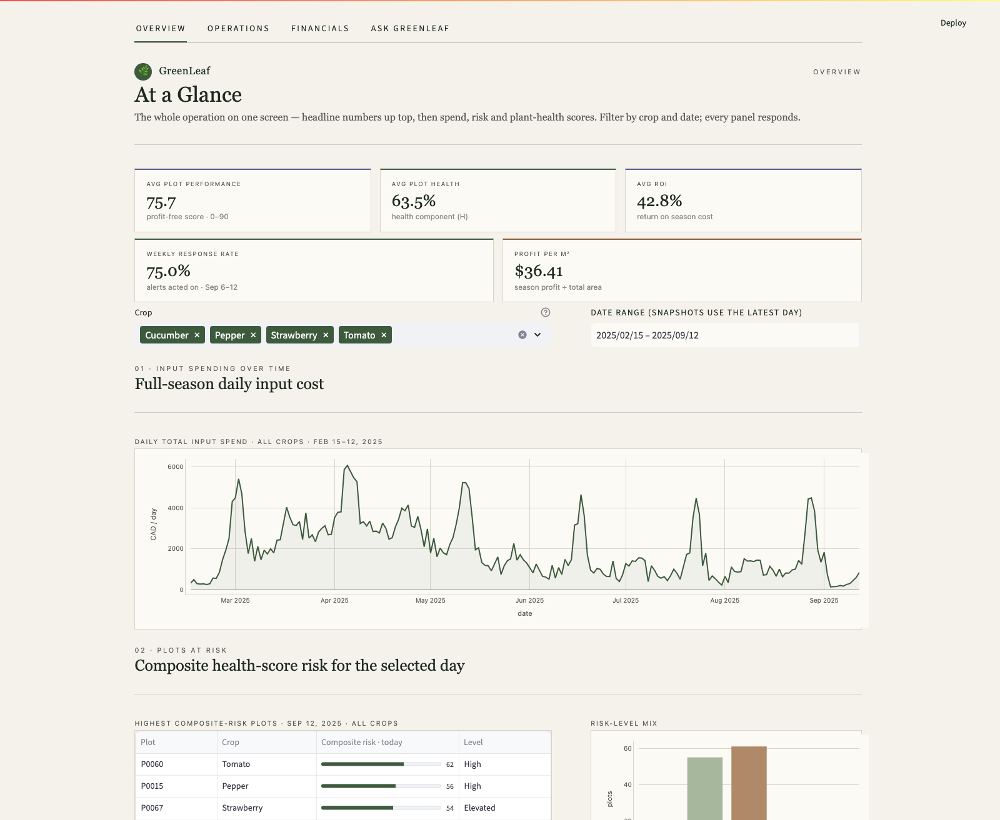
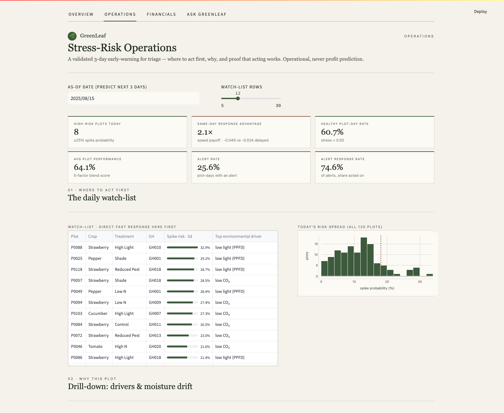
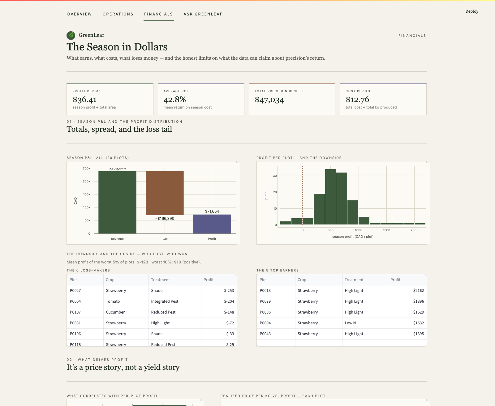
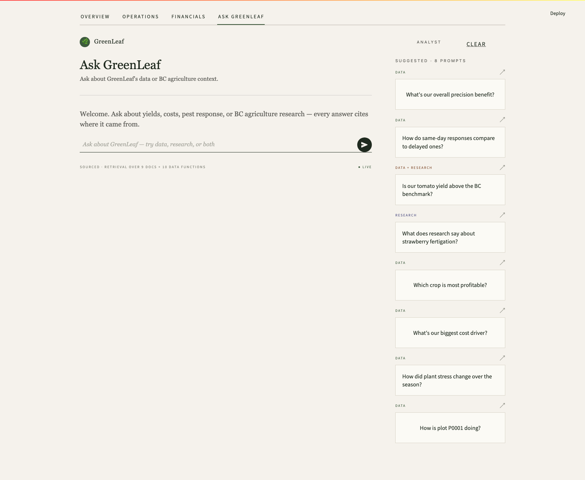

# GreenLeaf Dashboard

A Streamlit analytics dashboard with an **agentic RAG** chat assistant, built for the
RBC × BCCAI × SFU Beedie Agribusiness Analytics Hackathon 2026. It's built around
GreenLeaf CEA, a hypothetical B.C. controlled-environment agriculture operator.

The audience is a mix of farmers, RBC lender staff, and technical judges, so every
answer leads with numbers and cites where they came from.

## Where it started

This dashboard placed **2nd** at the RBC × BCCAI × SFU Beedie Agribusiness Analytics Hackathon (May 2026). It's
the starting point for GreenLeaf 2.0 in `control/`, a reinforcement-learning co-pilot for a greenhouse simulator.

> **Synthetic data.** The dashboard runs on the organisers' synthetic case (`data/raw/`), so no number in it is
> real-world evidence. Currency is CAD.

| Overview | Operations |
|---|---|
|  |  |
| **Financials** | **Ask GreenLeaf** |
|  |  |

- **Overview:** headline numbers, daily input spend, and the plots most at risk today.
- **Operations:** a 3-day stress early-warning and a daily watch-list.
- **Financials:** the season in dollars, the profit spread and the loss tail.
- **Ask GreenLeaf:** an agentic RAG chat that answers from the data and a small research corpus, citing its sources.

## Setup

```bash
python -m venv .venv
source .venv/bin/activate
pip install -e .
```

The chat assistant calls the **DeepSeek** chat API for routing and answer synthesis.
Put your key in a `.env` file at the repo root (gitignored):

```bash
DEEPSEEK_API_KEY=sk-...
```

Without a key the dashboard's data tabs still work; only the chat is disabled.

## Run

Python 3.12, from the repo root:

```bash
# 1. Launch the dashboard (the first start builds data/derived/ via build_derived.py)
python -m streamlit run app/streamlit_app/main.py

# 2. For the chat: build the RAG index once (downloads the embedding model; re-run
#    whenever docs/greenleaf_corpus/ changes) and set DEEPSEEK_API_KEY in .env
python -m app.rag.build_index
```

The app has four tabs: **Overview**, **Operations**, **Financials**, and
**Ask GreenLeaf** (the chat assistant).

## Tests

Build the derived data and the RAG index first (`python build_derived.py`, or start the app once, and
`python -m app.rag.build_index`), then:

```bash
pytest tests/
```

## Data layer

- `data/raw/` — source CSVs and case PDF (**read-only**, never modified).
- `data/external/` — external BC benchmarks (YAML, one per benchmark).
- `data/derived/` — joined/feature-engineered parquet, built by `build_derived.py` (gitignored).
- `docs/greenleaf_corpus/` — the curated markdown knowledge base the RAG searches.

`build_derived.py` is the single source of truth for derived data.

---

## How the chat works (agentic RAG)

The chat is **agentic RAG**: instead of always retrieving documents and stuffing them
into one prompt, an LLM agent is given a set of **tools** and decides — turn by turn —
which to call, looks at each result, and adjusts until it can answer. Document
retrieval is just one of those tools.

```
question
   │
   ▼
app/streamlit_app/chat_page.py   the Streamlit chat UI (render_chat)
   │
   ▼
app/chat/answer.py               public entry point; runs the agent, then cleans
   │                             the final text (strips "Let me…"/"you could ask…")
   ▼
app/chat/agent.py    ◀── THE AGENTIC LOOP ──▶  loops up to max_iterations:
   │                       DeepSeek picks tool(s) → run them → feed results back →
   │                       repeat or write the final cited answer
   ├── search_documents ──▶ app/rag/retrieve.py   (semantic search = the "R" in RAG)
   ├── 10 analytics tools ─▶ app/chat/data_queries.py   (pandas over the derived data)
   └── query_data ────────▶ app/chat/agent.py    (safe, flexible pandas escape hatch)
```

So the loop can: search the corpus, **see** the chunks, then call a data tool, look at
the numbers, retrieve again with a better query if needed, and only then answer — all
chosen by the model, not hard-coded. That autonomy is what makes it *agentic* RAG
rather than plain RAG.

### How the RAG part works

RAG itself is the classic two steps — **index** offline, **retrieve** at query time:

1. **Index** — `app/rag/build_index.py`
   Reads `docs/greenleaf_corpus/*.md`, strips YAML frontmatter, chunks each doc into
   ~300-word passages on paragraph boundaries, embeds them with the
   `all-MiniLM-L6-v2` sentence-transformer (L2-normalized), and writes
   `app/rag/index_data/embeddings.npy` + `chunks.json`. Run it once (and again after
   editing the corpus).

2. **Retrieve** — `app/rag/retrieve.py`
   Loads that index and the embedding model once, embeds the query with the same
   model, and returns the top-k chunks by cosine similarity (a numpy dot product,
   since both sides are normalized). `_search_topk()` is the single swap point if you
   ever move to a vector DB (FAISS, Chroma, pgvector).

## "Where is the agentic part? I only see `index` and `retrieve`"

`app/rag/` is **only the retrieval half of RAG** — `build_index.py` and `retrieve.py`.
The *agentic* work lives in **`app/chat/`**:

| File | Role |
|------|------|
| `app/chat/agent.py` | **The agent loop** — tool definitions + the gather→look→adjust loop that drives DeepSeek. This is the agentic RAG core. |
| `app/chat/data_queries.py` | The 10 analytics tools (pure pandas over the derived parquet). |
| `app/chat/answer.py` | Public entry point used by the UI; post-processes the final answer text. |
| `app/chat/router.py` | LLM key/`.env` loading + a legacy single-shot classifier (kept for reference; the agent loop in `agent.py` superseded it). |
| `app/rag/build_index.py` | Builds the corpus embedding index. |
| `app/rag/retrieve.py` | Semantic top-k retrieval over the index. |

The agent reaches retrieval via the `search_documents` tool in `agent.py`, which calls
`retrieve()`. So "index + retrieve" are the *ingredients*; `agent.py` is the *cook*.

## Project structure

- `app/streamlit_app/` — Streamlit pages (`main.py` shell + one module per tab).
- `app/chat/` — agentic chat: agent loop, data tools, answer entry point.
- `app/rag/` — corpus index builder + retrieval.
- `analysis/`, `models/` — exploratory analyses and trained model artifacts.
- `docs/` — supporting docs; `docs/greenleaf_corpus/` is the RAG source.
- `tests/` — pytest suite.
- `build_derived.py` — single source of truth for derived data.
