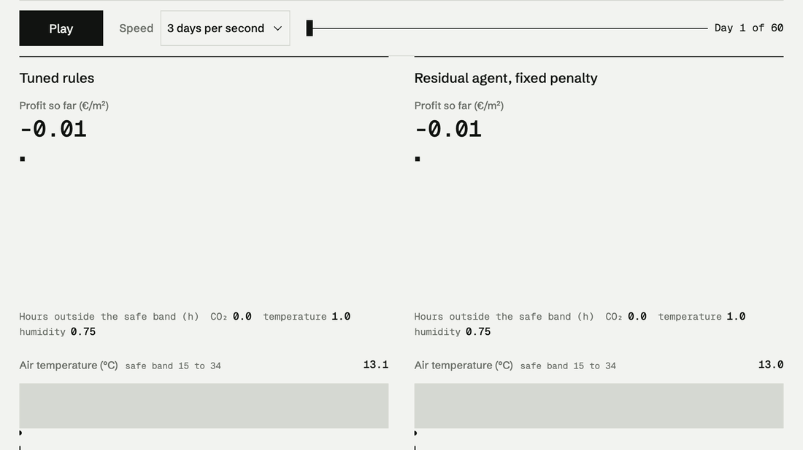
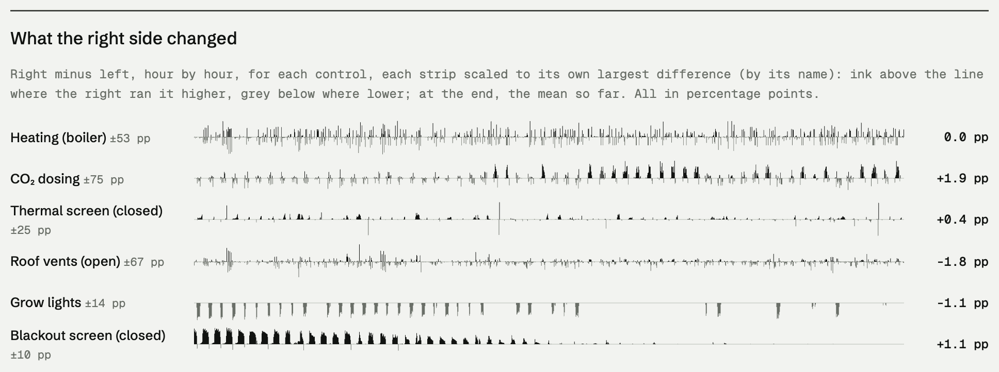
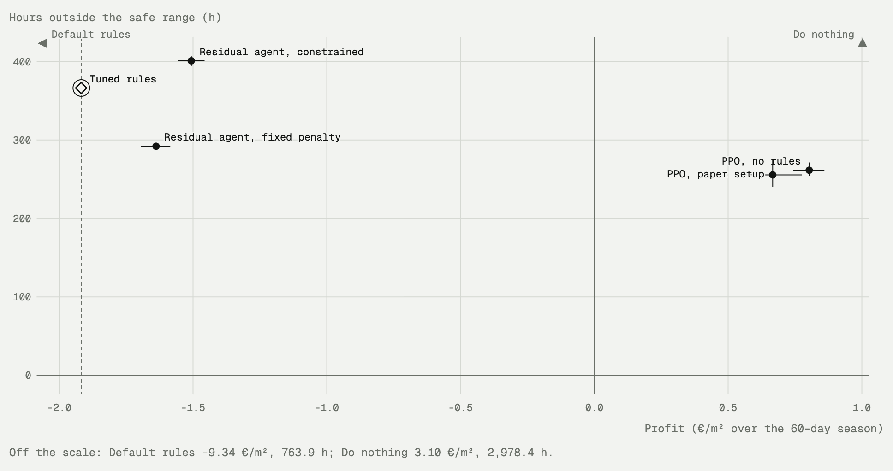

# GreenLeaf 2.0: teaching agents to grow tomatoes

Residual reinforcement-learning agents run a simulated tomato greenhouse on top of the grower's rule-based controller,
in Wageningen University's [GreenLight-Gym](https://github.com/BartvLaatum/GreenLight-Gym2) simulator. On held-out
2012 weather in Amsterdam, London and Abbotsford, the residual agent beat a tuned rule-based controller on profit and on
hours outside the climate bounds, and grew more fruit.

Live demo: https://aarmens702-hub.github.io/greenleaf-dashboard/ (simulated seasons, replayed in the browser)

[](https://aarmens702-hub.github.io/greenleaf-dashboard/)

*Amsterdam 2012, start day 45: the tuned rules (left) and the residual agent with a fixed penalty, seed 100 (right),
through one 60-day season. 2012 test weather, scored once; simulated.*

The full write-up, with every experiment, drop and limitation, is [docs/REPORT.md](docs/REPORT.md).

## How it works

- Every 15 minutes the grower's rule-based controller proposes settings for 6 controls: boiler, CO₂ dosing, thermal
  screen, roof vents, lamps and blackout screen.
- A Stable-Baselines3 PPO policy adds a residual to each control, clipped to ±15% of its range, so a zero residual runs
  the greenhouse on the rules alone.
- The reward is scaled profit minus a weighted penalty for leaving the CO₂, temperature and humidity bounds
  (300 to 1600 ppm, 15 to 34 °C, 50 to 85% relative humidity); the residual agent uses a fixed weight of 0.5.
- The constrained variant learns PID-Lagrangian multipliers on temperature and humidity instead, each held to a budget
  equal to the tuned rules' own mean violation cost on training weather; CO₂ keeps a fixed weight of 1.
- The baseline is the same rule-based controller with its 12 setpoints tuned by 200 trials of Optuna's TPE sampler.
  Each residual agent trains for 2,000,000 steps on Amsterdam 2008, 2009 and 2011 weather, and its checkpoint is
  selected on Amsterdam 2010; London and Abbotsford are climates it never saw.



*What the residual agent changed in the replay above: right minus left, hour by hour, for each control, in percentage
points, each strip on its own scale. Simulated.*

## Results (2012 test weather, scored once)

| City | Profit gain over the tuned rules, €/m² [95% CI] | Hours outside the bounds: residual agent vs tuned rules | Fruit growth, kg/m²: residual agent vs tuned rules |
|---|---|---|---|
| Amsterdam | +0.30 [0.25, 0.35] | 292.6 vs 365.2 | 8.77 vs 8.59 |
| London | +0.40 [0.35, 0.44] | 343.1 vs 456.9 | 9.15 vs 8.89 |
| Abbotsford BC | +0.54 [0.47, 0.61] | 444.3 vs 559.8 | 8.42 vs 8.28 |

The residual agent passed the decision rule registered before the final in all three cities: its profit CI lies above
the tuned rules' profit, its hours are at or below theirs, and no episode failed. The constrained variant also earned
more than the tuned rules in every city (+0.38, +0.46 and +0.63 €/m²) and passed the rule in London and Abbotsford, but
in Amsterdam it spent more hours outside the bounds than the tuned rules (399.9 vs 365.2 h).



*Amsterdam 2012, from the live demo's Results section: each controller's profit against its hours outside the bounds,
IQMs with 95% CIs. Hollow diamond: the tuned rules. Default rules and Do nothing are off the scale, marked on its edge.
The chart's hours are the IQM of each season's total, so they differ slightly from the table's sums.*

Gains are IQMs of each season's profit minus the tuned rules' on the same season, over 10 seeds × 8 seasons of 60 days
per city, with 95% stratified bootstrap CIs. Hours are the sum of the CO₂, temperature and humidity IQMs of season hours
outside the bounds. Fruit growth is the net change in standing fruit over the season, not harvest. In the code and the
report the residual agent is `residual_w05` and the constrained variant `lag_b100`. Source:
`control/results/analysis/<split>/summary.csv`, checked against the ledger's final-result-aee23915 row. The same
chart for London and Abbotsford, interactive, is in the live demo's Results section; the full tables, with every
controller and per-constraint hours, are in [docs/REPORT.md §5](docs/REPORT.md#5-the-final).

## What we learned

- **End-to-end PPO earned more by growing less.** PPO without the rules (5 seeds) gained 2.74, 2.08 and 3.25 €/m² over
  the tuned rules with fewer hours outside the bounds (260.8, 239.2 and 232.8 h) by growing 28% to 32% less fruit
  (5.96, 6.41 and 5.65 kg/m²); the energy and CO₂ it saved outweighed the fruit it lost, no registered rule guarded
  fruit growth, and profit does not value the crop's condition at day 60.
- **Doing nothing earns the most.** With every actuator off, profit is the highest of any controller (3.10, 3.21 and
  1.91 €/m²) at about 3,000 hours outside the bounds (2977.5, 3058.7 and 3013.1 h), so profit is only read next to
  hours.
- **The margins are small.** The residual variants gain a few tenths of a euro per m² a season (0.30 to 0.63 €/m²), and
  profit stays negative for the tuned rules and both variants in Amsterdam and Abbotsford.
- **Both residual variants sometimes left the CO₂ bounds, which the tuned rules never did:** the residual agent in 29
  of its 240 test seasons and the constrained variant in 18 of 240, against 0 of 24 for the tuned rules.
- **The Amsterdam gain shrank out of sample.** The residual agent's 0.30 [0.25, 0.35] €/m² lies below its validation
  gain of 0.49 [0.40, 0.57] without overlapping.

What held, what didn't and the limitations, in full: [docs/REPORT.md §5.2](docs/REPORT.md#52-what-held-and-what-didnt)
and [§6](docs/REPORT.md#6-limitations).

## How the numbers are kept honest

- **Registered experiments.** Each experiment's hypothesis, arms, seeds, metrics and decision rule were written on its
  GitHub issue and recorded in the ledger before the first run, and every result and decision, drops included, is
  recorded against it ([docs/PROTOCOL.md](docs/PROTOCOL.md)).
- **The seal.** The 2012 test weather was scored once, on checkpoints already selected on validation; the
  `final-result` row spent the seal, and the ledger, `evaluate` and `scripts/check_locks.py` each refuse a second run.
- **An append-only ledger.** `control/ledger/ledger.jsonl` is written only by its CLI, every row carries sha256
  fingerprints of the scoring code and the protocol, and `check_locks.py` proves from git history that rows were only
  appended.
- **Like-for-like baselines.** The tuned rules were fixed before any agent was compared with them. In the final, each
  agent is compared with them on the same seasons, through the same IQM at the agent's seed count; REPORT.md §3.5
  regrades the earlier experiments that used a plain mean.

## Reproduce

Needs git and [uv](https://docs.astral.sh/uv/); `uv sync` builds the locked Python 3.12 environment.

```bash
git clone https://github.com/aarmens702-hub/greenleaf-dashboard
cd greenleaf-dashboard/control && uv sync
uv run pytest -q -m "not slow"
uv run python -m greenleaf_control.report --split amsterdam_2012
```

- The fast tests are offline and need no keys. `uv run pytest -q` adds the slow ladder (the probes and the golden
  numbers, which are pinned on arm64 macOS).
- `report --split amsterdam_2012` (or `london_2012`, `abbotsford_2012`) rebuilds `control/results/analysis/<split>/`
  from the final's committed seasons (`control/results/final/final-registered-4d0a4ba9/seasons.parquet`) and the
  ledger, and refuses to write unless its numbers match final-result-aee23915. It plays no season, so the test weather
  is not scored again.
- `report --split validation` needs the run directories, which are git-ignored (`control/runs/`), so on a fresh clone
  it refuses; the committed `control/results/analysis/validation/summary.csv` is its output. See
  [REPORT.md §7](docs/REPORT.md#7-reproduce).
- `uv run python -m greenleaf_control.ledger show` prints every ledger row.

## How it fits together

```
grower's rules (rb_tuned): upstream's rule-based controller, 12 setpoints tuned with Optuna
   │  proposes u_rb, 6 controls in [0, 1], every 15 minutes
   ▼
residual agent (PPO): u = clip(u_rb + 0.15 · a, 0, 1), a in [-1, 1]⁶, so at most ±15% of each control's range
   │  residual_w05: a fixed violation penalty (w = 0.5)
   │  lag_b100: PID-Lagrangian multipliers on temperature and RH; CO₂'s multiplier fixed at 1 (its budget is 0)
   ▼
GreenLight-Gym tomato simulator (pinned at 2d3febb), 60-day seasons
   │  raw states and controls
   ▼
metrics.py: profit (€/m²) and hours outside the CO₂, temperature and RH ranges; never imports the reward code
   │  IQM [95% CI] over seeds × seasons (stats.py, report.py)
   ▼
ledger (control/ledger/ledger.jsonl): registered → run → run-end → result → decision; final-registered → final-result
```

The code is in `control/greenleaf_control/` (`rule_based.py`, `envs.py`, `lagrangian.py`, `metrics.py`, `ledger.py`).
The research brief is [docs/PRD.md](docs/PRD.md) and the evaluation protocol is [docs/PROTOCOL.md](docs/PROTOCOL.md).

## Where it started: the hackathon dashboard (frozen)

GreenLeaf began as a Streamlit dashboard with an agentic RAG chat assistant, which placed **2nd** at the RBC × BCCAI ×
SFU Beedie Agribusiness Analytics Hackathon (May 2026). It's built around GreenLeaf CEA, a hypothetical B.C.
controlled-environment agriculture operator. The audience was a mix of farmers, RBC lender staff and technical judges,
so every answer leads with numbers and cites where they came from. It lives at the repo root and is frozen, kept as the
record of what placed 2nd.

> **Synthetic data.** The dashboard runs on the organisers' synthetic case (`data/raw/`), so no number in it is
> real-world evidence. Currency is CAD.

| Overview | Operations |
|---|---|
|  |  |
| **Financials** | **Ask GreenLeaf** |
|  |  |

- **Overview:** headline numbers, daily input spend, and the plots most at risk today.
- **Operations:** a 3-day stress early-warning and a daily watch-list.
- **Financials:** the season in dollars, the profit spread and the loss tail.
- **Ask GreenLeaf:** an agentic RAG chat that answers from the data and a small research corpus, citing its sources.

### Run it

Python 3.12, from the repo root:

```bash
python -m venv .venv
source .venv/bin/activate
pip install -e .

# 1. Launch the dashboard (the first start builds data/derived/ via build_derived.py)
python -m streamlit run app/streamlit_app/main.py

# 2. For the chat: build the RAG index once (downloads the embedding model; re-run
#    whenever docs/greenleaf_corpus/ changes) and set DEEPSEEK_API_KEY in .env
python -m app.rag.build_index
```

The chat assistant calls the **DeepSeek** chat API for routing and answer synthesis. Put your key in a `.env` file at
the repo root (gitignored):

```bash
DEEPSEEK_API_KEY=sk-...
```

Without a key the dashboard's data tabs still work; only the chat is disabled.

Tests: build the derived data and the RAG index first (`python build_derived.py`, or start the app once, and
`python -m app.rag.build_index`), then run `pytest tests/`.

### How the chat works (agentic RAG)

Instead of always retrieving documents and stuffing them into one prompt, an LLM agent is given a set of **tools** and
decides, turn by turn, which to call, looks at each result, and adjusts until it can answer. Document retrieval is one
of those tools.

```
question
   │
   ▼
app/streamlit_app/chat_page.py   the Streamlit chat UI (render_chat)
   │
   ▼
app/chat/answer.py               public entry point; runs the agent, then cleans
   │                             the final text (strips "Let me…"/"you could ask…")
   ▼
app/chat/agent.py    ◀── THE AGENTIC LOOP ──▶  loops up to max_iterations:
   │                       DeepSeek picks tool(s) → run them → feed results back →
   │                       repeat or write the final cited answer
   ├── search_documents ──▶ app/rag/retrieve.py   (semantic search = the "R" in RAG)
   ├── 10 analytics tools ─▶ app/chat/data_queries.py   (pandas over the derived data)
   └── query_data ────────▶ app/chat/agent.py    (safe, flexible pandas escape hatch)
```

The loop can search the corpus, see the chunks, call a data tool, look at the numbers, retrieve again with a better
query if needed, and only then answer, all chosen by the model, not hard-coded.

| File | Role |
|------|------|
| `app/chat/agent.py` | **The agent loop:** tool definitions and the gather, look, adjust loop that drives DeepSeek. It reaches retrieval through its `search_documents` tool, which calls `retrieve()`. |
| `app/chat/data_queries.py` | The 10 analytics tools (pure pandas over the derived parquet). |
| `app/chat/answer.py` | Public entry point used by the UI; post-processes the final answer text. |
| `app/chat/router.py` | LLM key and `.env` loading, plus a legacy single-shot classifier (kept for reference; `agent.py` superseded it). |
| `app/rag/build_index.py` | **Index:** reads `docs/greenleaf_corpus/*.md`, strips YAML frontmatter, chunks each doc into ~300-word passages on paragraph boundaries, embeds them with the `all-MiniLM-L6-v2` sentence-transformer (L2-normalized), and writes `app/rag/index_data/embeddings.npy` and `chunks.json`. Run it once, and again after editing the corpus. |
| `app/rag/retrieve.py` | **Retrieve:** embeds the query with the same model and returns the top-k chunks by cosine similarity (a numpy dot product, since both sides are normalized). `_search_topk()` is the single swap point for a vector DB (FAISS, Chroma, pgvector). |

### Data and layout

- `data/raw/`: source CSVs and the case PDF (**read-only**, never modified).
- `data/external/`: external BC benchmarks (YAML, one per benchmark).
- `data/derived/`: joined and feature-engineered parquet, built by `build_derived.py`, the single source of truth for
  derived data (gitignored).
- `docs/greenleaf_corpus/`: the curated markdown knowledge base the RAG searches.
- `app/streamlit_app/`: Streamlit pages (the `main.py` shell and one module per tab).
- `app/chat/` and `app/rag/`: the agentic chat, and the corpus index builder and retrieval.
- `analysis/`, `models/`: exploratory analyses and trained model artifacts.
- `tests/`: the dashboard's pytest suite.
