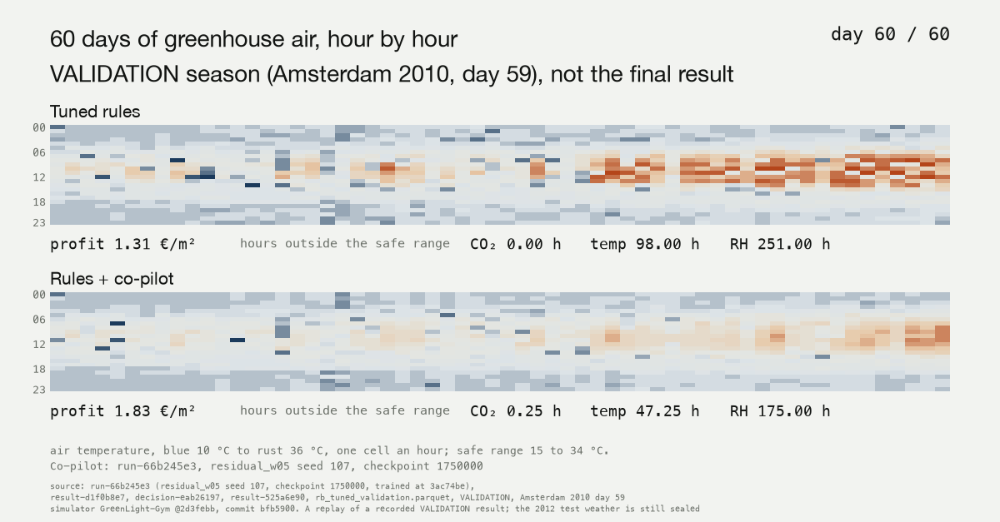
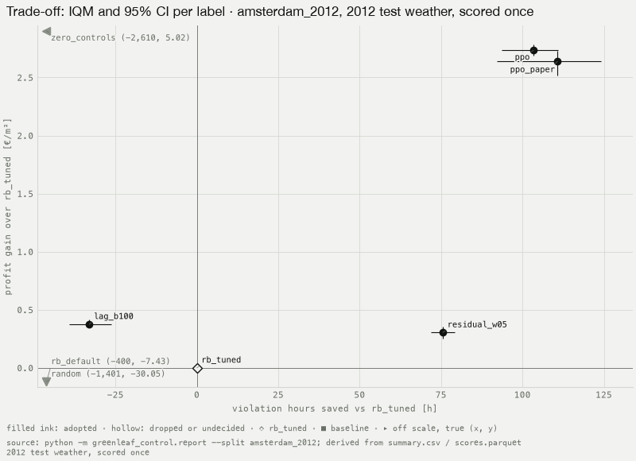
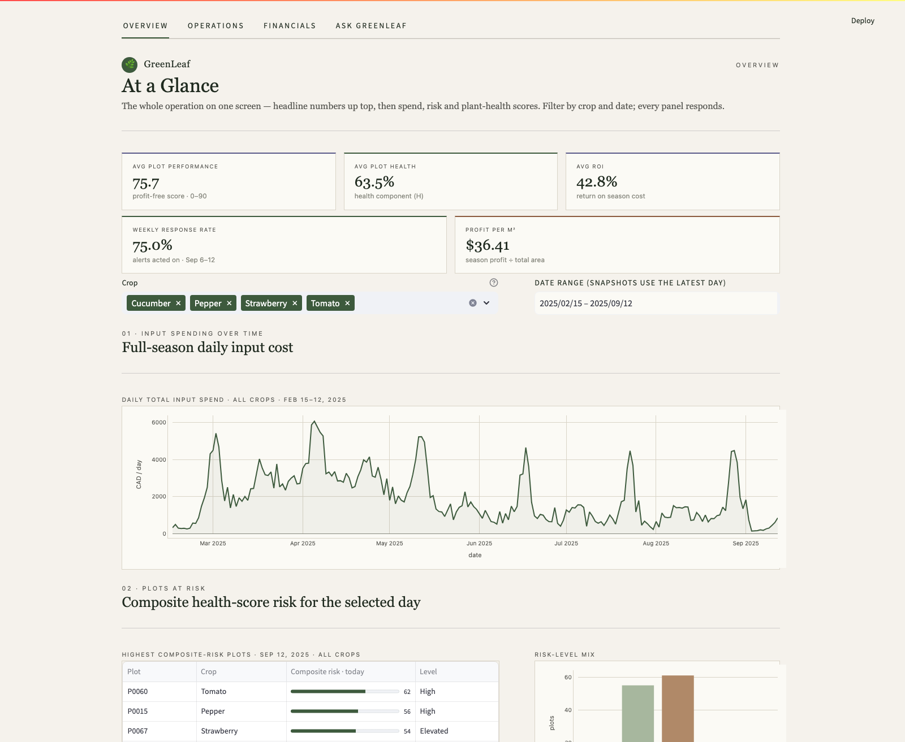
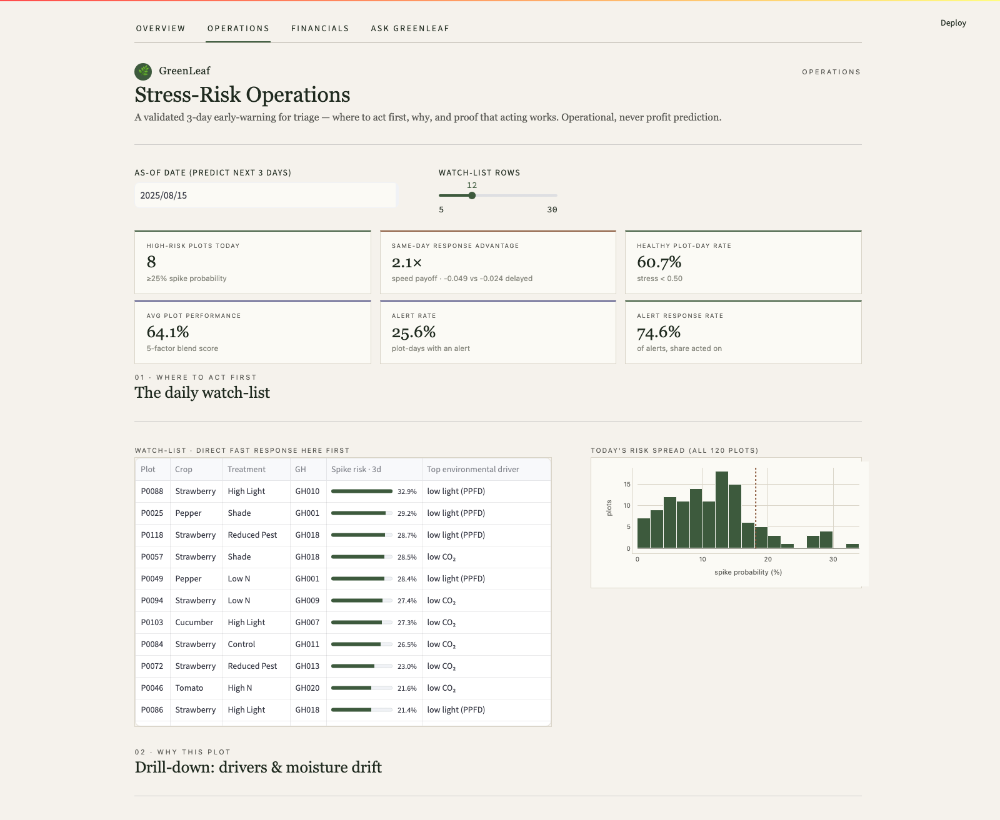
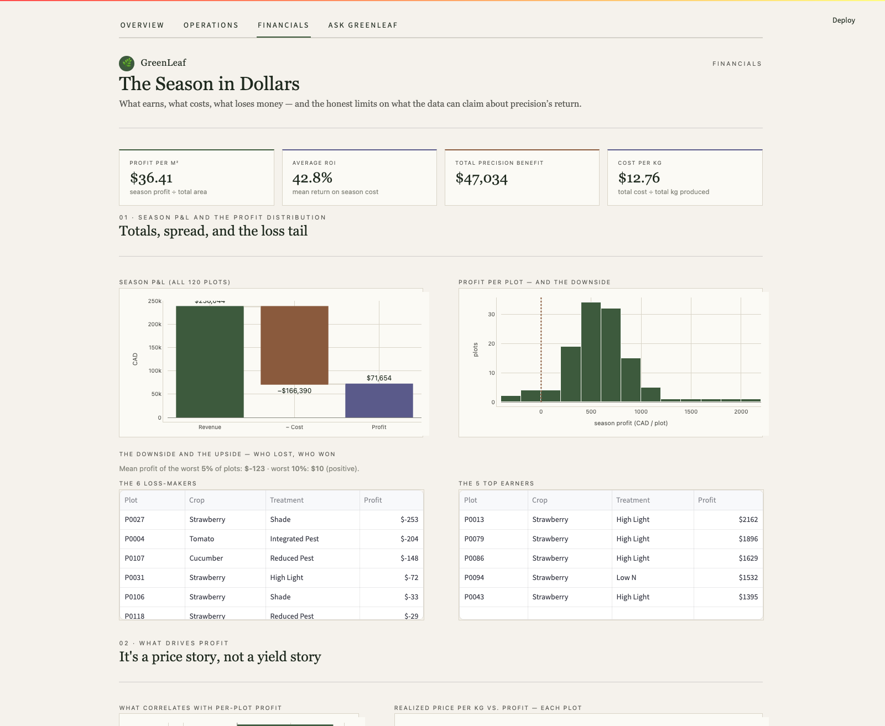
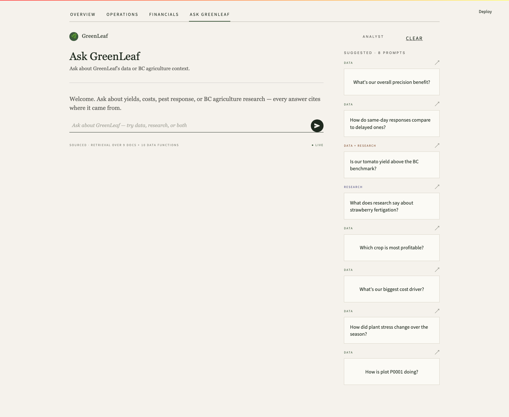

# GreenLeaf 2.0

A reinforcement-learning co-pilot that adjusts a grower's tuned climate rules in a simulated tomato greenhouse
([GreenLight-Gym](https://github.com/BartvLaatum/GreenLight-Gym2)), scored once on held-out 2012 weather under a
protocol registered before each run.

[](docs/media/duel_replay.gif)

*A VALIDATION season (Amsterdam 2010, start day 59), not the final result. Each cell is one hour of air temperature
over 60 days: the tuned rules (`rb_tuned`) above, the rules plus the fixed-penalty co-pilot below (`residual_w05` seed
107, run-66b245e3, checkpoint 1750000, the lower-median seed of E6 by day-59 profit, not the best seed). A replay of a
recorded validation result (result-d1f0b8e7). Click the image for the day-by-day replay.*

The write-up, with every experiment, drop and limitation, is [docs/REPORT.md](docs/REPORT.md).

## Results (2012 test weather, scored once)

The final scored 30 checkpoints, each selected on validation and registered in advance (final-registered-4d0a4ba9),
and 4 baselines once on three test splits: a new year (Amsterdam 2012) and two new climates (London and Abbotsford BC,
2012), each 8 seasons of 60 days from start days 45 to 73. Its record is final-result-aee23915. The table shows the two
co-pilots, 10 seeds each, against the tuned rules on the same seasons. `residual_w05` has a fixed violation penalty
(w = 0.5). `lag_b100` has PID-Lagrangian multipliers on temperature and RH, each with a budget of 100% of the tuned
rules' mean per-step cost on TRAIN_EVAL; CO₂'s budget is 0, so under PROTOCOL v2 its multiplier is fixed at 1.

| Test split | `residual_w05` gain, €/m² [95% CI] | Σ hours (`rb_tuned`) | Grade | `lag_b100` gain, €/m² [95% CI] | Σ hours (`rb_tuned`) | Grade |
|---|---|---|---|---|---|---|
| amsterdam_2012 | 0.30 [0.25, 0.35] | 292.6 (365.2) | verified | 0.38 [0.35, 0.42] | 399.9 (365.2) | fails (b) |
| london_2012 | 0.40 [0.35, 0.44] | 343.1 (456.9) | verified | 0.46 [0.43, 0.49] | 444.2 (456.9) | verified |
| abbotsford_2012 | 0.54 [0.47, 0.61] | 444.3 (559.8) | verified | 0.63 [0.59, 0.67] | 551.5 (559.8) | verified |

*Gain: the IQM of each season's profit minus `rb_tuned`'s on the same season, over 10 seeds × 8 seasons, with a 95%
stratified-bootstrap CI. Σ hours: the sum of the CO₂, temperature and humidity (RH) IQMs of season hours outside the
safe range, with `rb_tuned`'s in parentheses. P(profit above `rb_tuned`'s same season) is 0.91 for `residual_w05` in
Amsterdam and 1.00 in every other cell. Grade: #45's rule, fixed before the run; a claim is verified only if (a) the
arm's profit IQM CI lies entirely above `rb_tuned`'s profit scored like for like, (b) its Σ hours are at or below
`rb_tuned`'s, and (c) scoring had 0 invalid episodes and 0 solver failures. Source:
`control/results/analysis/<split>/summary.csv`, checked against final-result-aee23915.*

What didn't hold:
- **The registered headline.** The PRD's headline required the constrained co-pilot, `lag_b100`, to pass on all three
  splits, and it fails rule (b) in Amsterdam, where its Σ of 399.9 h is above the tuned rules' 365.2 h; `residual_w05`
  passes on every split.
- **Plain PPO earned more, with fewer hours.** `ppo` and `ppo_paper` (5 seeds each), which ignore the rules, beat
  either co-pilot on profit and on Σ hours on every split (gains of 2.08 to 3.36 €/m² at Σ 227.1 to 260.8 h) while
  growing about 30% less fruit than the co-pilots (REPORT.md §5.2). Profit charges for that fruit at €1.60/kg, but
  the energy and CO₂ costs PPO saves, with the lamps and CO₂ dosing off in almost every hour of the seed-0 replays
  (REPORT.md §5.2), are larger than the fruit revenue it loses; nothing in #45's rule guards fruit growth, and nothing
  values the crop still on the plants at day 60 (REPORT.md §6).
- **Doing nothing earns the most.** `zero_controls`, every actuator off, has the highest profit on every split (3.10,
  3.21 and 1.91 €/m²) at Σ 2977.5, 3058.7 and 3013.1 h, which is why profit is read only next to violation hours.
- **The margins are small.** The co-pilots' gains are a few tenths of a euro per m² a season, on profits that stay
  negative for the tuned rules and both co-pilots in Amsterdam and Abbotsford.
- **The fixed-penalty gain shrank in Amsterdam.** `residual_w05`'s Amsterdam gain, 0.30 [0.25, 0.35] €/m², lies below
  its validation gain of 0.49 [0.40, 0.57] without overlapping (validation summary.csv, residual_w05 #36/f2fd);
  London's and Abbotsford's CIs overlap it (REPORT.md §5.2).
- **Both co-pilots sometimes broke the CO₂ range, which the tuned rules never did.** `residual_w05` had CO₂ hours in 29
  of its 240 test seasons (at most 12.2 h in one), `lag_b100` in 18 of 240 (at most 6.2 h), and `rb_tuned` in 0 of
  24; the Σ column hides this (REPORT.md §5.2, from the final's `seasons.parquet`).

Every arm and baseline per split, with per-constraint hours and fruit growth:
[docs/REPORT.md §5](docs/REPORT.md#5-the-final).



*amsterdam_2012 (2012 test weather, scored once): each label at (violation hours saved, profit gain) against
`rb_tuned`'s same season, IQM with 95% CIs; up and to the right beats the tuned rules on both. Hours saved is the IQM
of each season's total hours outside the safe ranges subtracted from `rb_tuned`'s on the same season. `lag_b100` sits
left of zero, at -33.1 [-39.1, -26.3] h saved. Baselines off the scale are marked at the edge with their true values.
Drawn by `report --split amsterdam_2012` from summary.csv; London's and Abbotsford's are in REPORT.md §5.*

## How the numbers are kept honest

- **Registered experiments.** Each experiment's hypothesis, arms, seeds, metrics and decision rule were written on its
  GitHub issue and recorded in the ledger before the first run, and every result and decision, drops included, is
  recorded against that registration ([docs/PROTOCOL.md](docs/PROTOCOL.md)).
- **The seal.** The 2012 test weather was scored once, on checkpoints already selected on validation; the
  `final-result` row spent the seal, and the ledger, `evaluate` and `scripts/check_locks.py` each refuse a second run.
- **An append-only ledger.** `control/ledger/ledger.jsonl` is written only by its CLI, every row carries sha256
  fingerprints of the scoring code and the protocol, and `check_locks.py` proves from git history that rows were only
  appended.
- **Like-for-like baselines.** The rule-based controller's 12 setpoints were tuned with Optuna TPE (200 trials) before
  any RL arm was compared with it. From E5b on and in the final, each arm is compared with it on the same seasons,
  through the same IQM at the arm's seed count; E2 to E5's rules used a baseline's plain mean, and REPORT.md §3.5
  regrades them.

## Reproduce

Needs git and [uv](https://docs.astral.sh/uv/); `uv sync` builds the locked Python 3.12 environment.

```bash
git clone https://github.com/aarmens702-hub/greenleaf-dashboard
cd greenleaf-dashboard/control && uv sync
uv run pytest -q -m "not slow"
uv run python -m greenleaf_control.report --split amsterdam_2012
```

- The fast tests are offline and need no keys. `uv run pytest -q` adds the slow ladder (the probes and the golden
  numbers, which are pinned on arm64 macOS).
- `report --split amsterdam_2012` (or `london_2012`, `abbotsford_2012`) rebuilds `control/results/analysis/<split>/`
  from the final's committed seasons (`control/results/final/final-registered-4d0a4ba9/seasons.parquet`) and the
  ledger, and refuses to write unless its numbers match final-result-aee23915. It plays no season, so the test weather
  is not scored again.
- `report --split validation` needs the run directories, which are git-ignored (`control/runs/`), so on a fresh clone
  it refuses; the committed `control/results/analysis/validation/summary.csv` is its output. See
  [REPORT.md §7](docs/REPORT.md#7-reproduce).
- `uv run python -m greenleaf_control.ledger show` prints every ledger row.

## How it fits together

```
grower's rules (rb_tuned): upstream's rule-based controller, 12 setpoints tuned with Optuna
   │  proposes u_rb, 6 controls in [0, 1], every 15 minutes
   ▼
co-pilot (PPO residual): u = clip(u_rb + 0.15 · a, 0, 1), a in [-1, 1]⁶, so at most ±15% of each control's range
   │  residual_w05: a fixed violation penalty (w = 0.5)
   │  lag_b100: PID-Lagrangian multipliers on temperature and RH; CO₂'s multiplier fixed at 1 (its budget is 0)
   ▼
GreenLight-Gym tomato simulator (pinned at 2d3febb), 60-day seasons
   │  raw states and controls
   ▼
metrics.py: profit (€/m²) and hours outside the CO₂, temperature and RH ranges; never imports the reward code
   │  IQM [95% CI] over seeds × seasons (stats.py, report.py)
   ▼
ledger (control/ledger/ledger.jsonl): registered → run → run-end → result → decision; final-registered → final-result
```

The code is in `control/greenleaf_control/` (`rule_based.py`, `envs.py`, `lagrangian.py`, `metrics.py`, `ledger.py`).
The research brief is [docs/PRD.md](docs/PRD.md) and the evaluation protocol is [docs/PROTOCOL.md](docs/PROTOCOL.md).

## Where it started: the hackathon dashboard (frozen)

GreenLeaf began as a Streamlit dashboard with an agentic RAG chat assistant, which placed **2nd** at the RBC × BCCAI ×
SFU Beedie Agribusiness Analytics Hackathon (May 2026). It's built around GreenLeaf CEA, a hypothetical B.C.
controlled-environment agriculture operator. The audience was a mix of farmers, RBC lender staff and technical judges,
so every answer leads with numbers and cites where they came from. It lives at the repo root and is frozen, kept as the
record of what placed 2nd.

> **Synthetic data.** The dashboard runs on the organisers' synthetic case (`data/raw/`), so no number in it is
> real-world evidence. Currency is CAD.

| Overview | Operations |
|---|---|
|  |  |
| **Financials** | **Ask GreenLeaf** |
|  |  |

- **Overview:** headline numbers, daily input spend, and the plots most at risk today.
- **Operations:** a 3-day stress early-warning and a daily watch-list.
- **Financials:** the season in dollars, the profit spread and the loss tail.
- **Ask GreenLeaf:** an agentic RAG chat that answers from the data and a small research corpus, citing its sources.

### Run it

Python 3.12, from the repo root:

```bash
python -m venv .venv
source .venv/bin/activate
pip install -e .

# 1. Launch the dashboard (the first start builds data/derived/ via build_derived.py)
python -m streamlit run app/streamlit_app/main.py

# 2. For the chat: build the RAG index once (downloads the embedding model; re-run
#    whenever docs/greenleaf_corpus/ changes) and set DEEPSEEK_API_KEY in .env
python -m app.rag.build_index
```

The chat assistant calls the **DeepSeek** chat API for routing and answer synthesis. Put your key in a `.env` file at
the repo root (gitignored):

```bash
DEEPSEEK_API_KEY=sk-...
```

Without a key the dashboard's data tabs still work; only the chat is disabled.

Tests: build the derived data and the RAG index first (`python build_derived.py`, or start the app once, and
`python -m app.rag.build_index`), then run `pytest tests/`.

### How the chat works (agentic RAG)

Instead of always retrieving documents and stuffing them into one prompt, an LLM agent is given a set of **tools** and
decides, turn by turn, which to call, looks at each result, and adjusts until it can answer. Document retrieval is one
of those tools.

```
question
   │
   ▼
app/streamlit_app/chat_page.py   the Streamlit chat UI (render_chat)
   │
   ▼
app/chat/answer.py               public entry point; runs the agent, then cleans
   │                             the final text (strips "Let me…"/"you could ask…")
   ▼
app/chat/agent.py    ◀── THE AGENTIC LOOP ──▶  loops up to max_iterations:
   │                       DeepSeek picks tool(s) → run them → feed results back →
   │                       repeat or write the final cited answer
   ├── search_documents ──▶ app/rag/retrieve.py   (semantic search = the "R" in RAG)
   ├── 10 analytics tools ─▶ app/chat/data_queries.py   (pandas over the derived data)
   └── query_data ────────▶ app/chat/agent.py    (safe, flexible pandas escape hatch)
```

The loop can search the corpus, see the chunks, call a data tool, look at the numbers, retrieve again with a better
query if needed, and only then answer, all chosen by the model, not hard-coded.

| File | Role |
|------|------|
| `app/chat/agent.py` | **The agent loop:** tool definitions and the gather, look, adjust loop that drives DeepSeek. It reaches retrieval through its `search_documents` tool, which calls `retrieve()`. |
| `app/chat/data_queries.py` | The 10 analytics tools (pure pandas over the derived parquet). |
| `app/chat/answer.py` | Public entry point used by the UI; post-processes the final answer text. |
| `app/chat/router.py` | LLM key and `.env` loading, plus a legacy single-shot classifier (kept for reference; `agent.py` superseded it). |
| `app/rag/build_index.py` | **Index:** reads `docs/greenleaf_corpus/*.md`, strips YAML frontmatter, chunks each doc into ~300-word passages on paragraph boundaries, embeds them with the `all-MiniLM-L6-v2` sentence-transformer (L2-normalized), and writes `app/rag/index_data/embeddings.npy` and `chunks.json`. Run it once, and again after editing the corpus. |
| `app/rag/retrieve.py` | **Retrieve:** embeds the query with the same model and returns the top-k chunks by cosine similarity (a numpy dot product, since both sides are normalized). `_search_topk()` is the single swap point for a vector DB (FAISS, Chroma, pgvector). |

### Data and layout

- `data/raw/`: source CSVs and the case PDF (**read-only**, never modified).
- `data/external/`: external BC benchmarks (YAML, one per benchmark).
- `data/derived/`: joined and feature-engineered parquet, built by `build_derived.py`, the single source of truth for
  derived data (gitignored).
- `docs/greenleaf_corpus/`: the curated markdown knowledge base the RAG searches.
- `app/streamlit_app/`: Streamlit pages (the `main.py` shell and one module per tab).
- `app/chat/` and `app/rag/`: the agentic chat, and the corpus index builder and retrieval.
- `analysis/`, `models/`: exploratory analyses and trained model artifacts.
- `tests/`: the dashboard's pytest suite.
