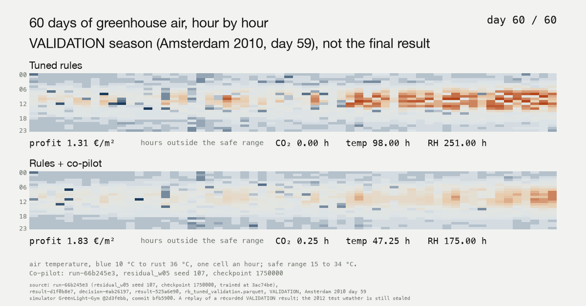
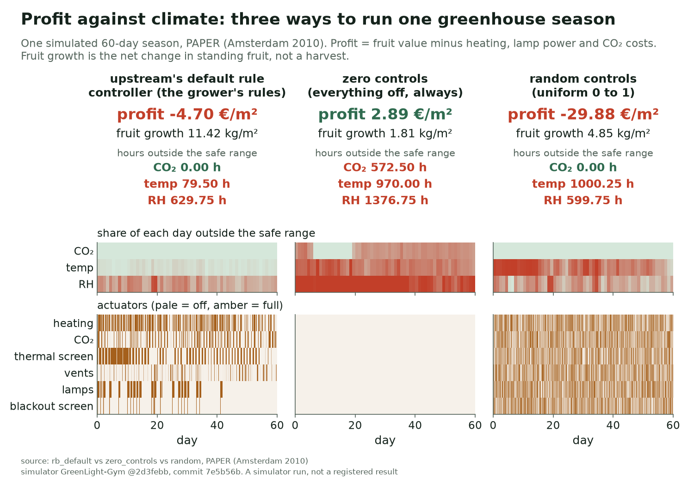
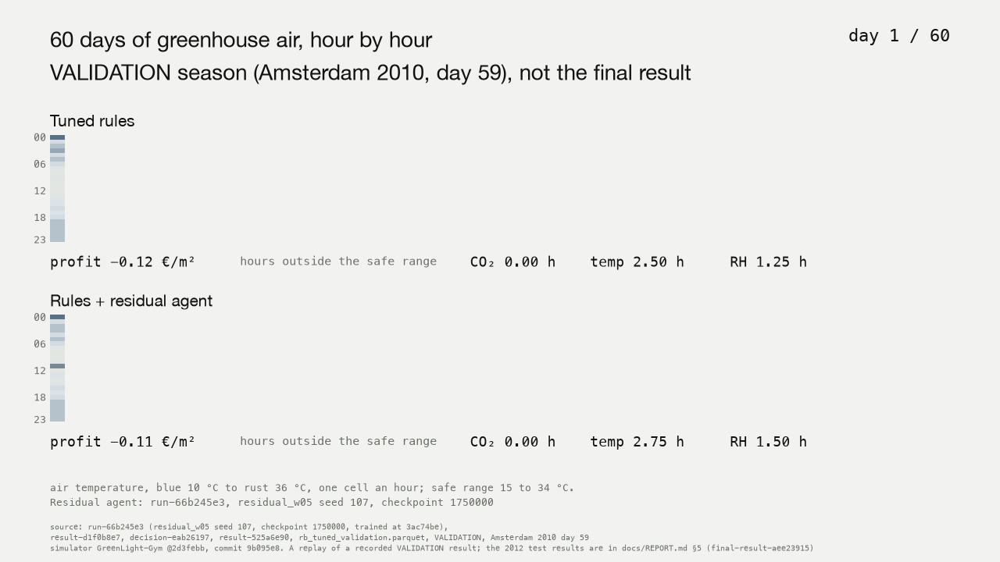
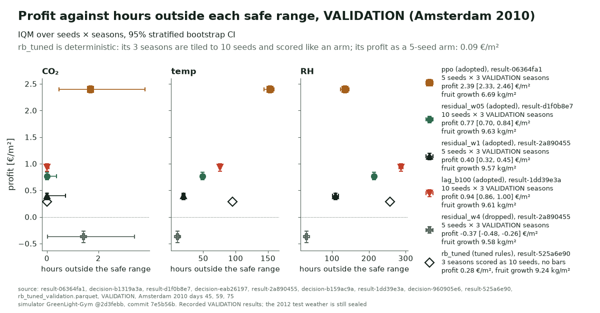
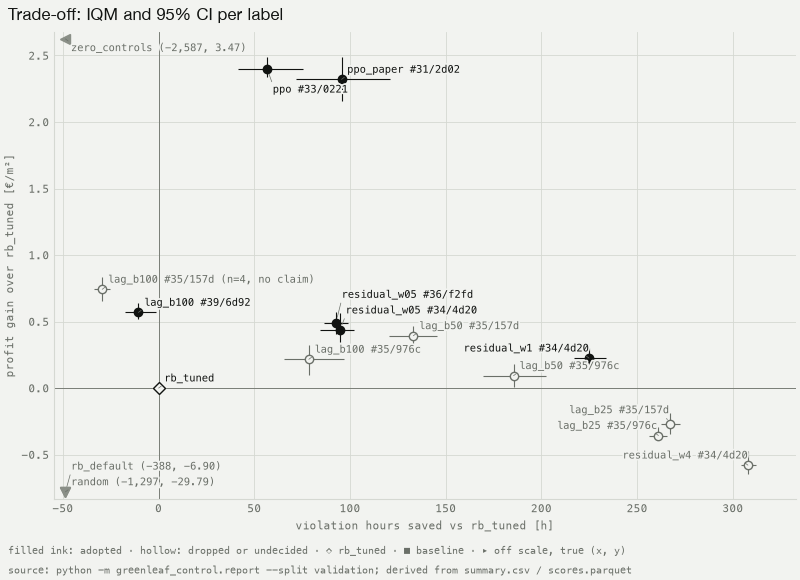
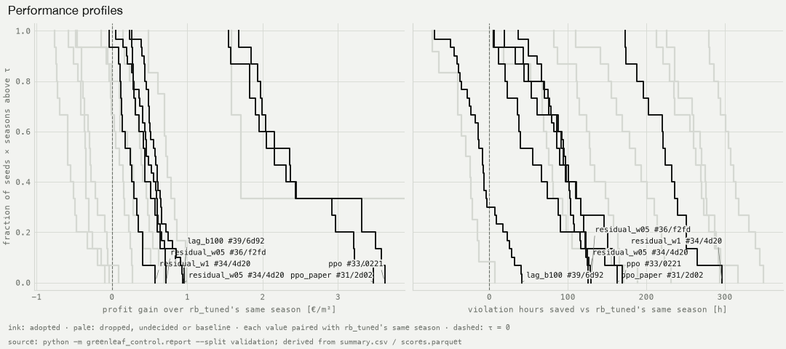
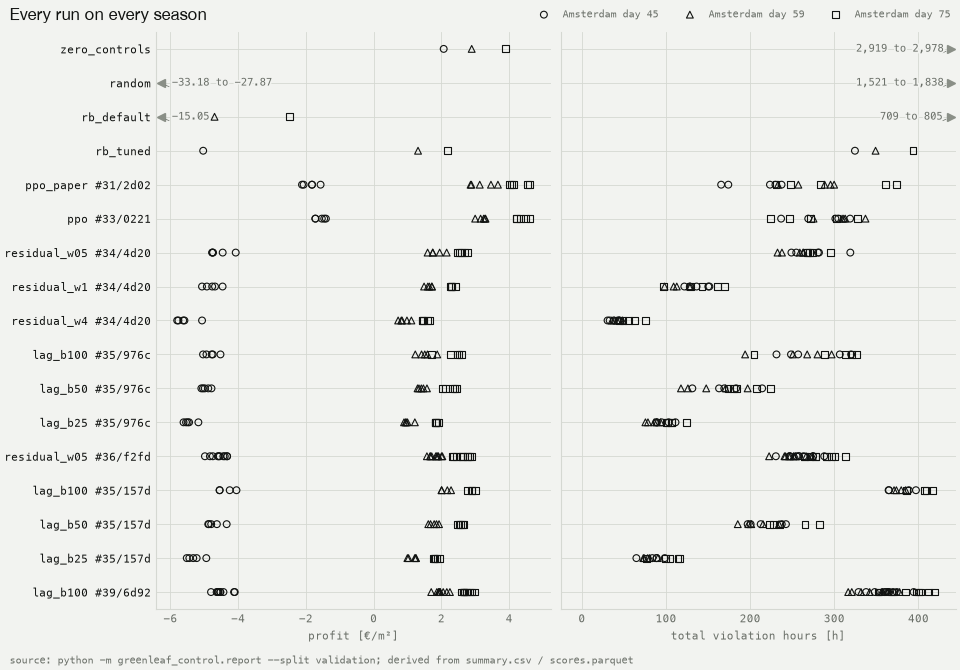
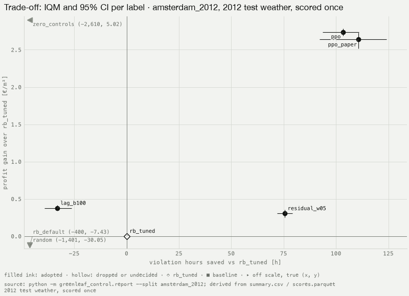
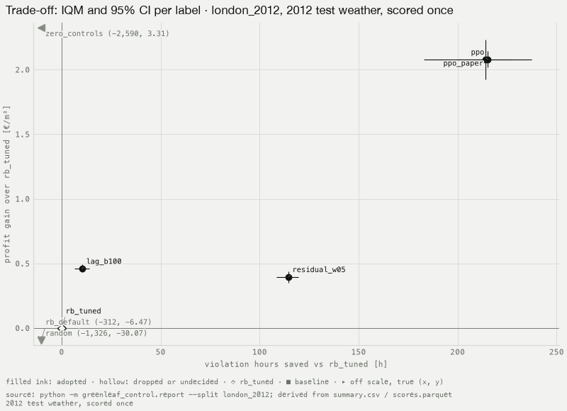
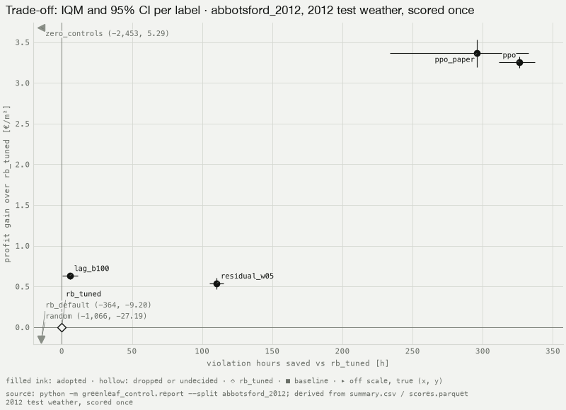

# GreenLeaf 2.0: a constrained residual co-pilot for greenhouse climate control, under a registered protocol

**Aarmen Sidhu**

November 2026

Code, ledger and results: `github.com/aarmens702-hub/greenleaf-dashboard`, in `control/`.

## Abstract

Greenhouse climate control trades fruit revenue against the cost of heating, lighting and CO₂ while keeping CO₂, air temperature and humidity inside safe ranges, and reinforcement-learning (RL) controllers for it have been reported against rule-based baselines that were never tuned. We train a residual PPO policy, a co-pilot that may move each of six controls by at most 0.15 of its range away from the action of a rule-based controller whose 12 setpoints we tuned with Optuna TPE, in two variants in the GreenLight-Gym tomato simulator: one with a fixed penalty on climate violations, and one with a PID-Lagrangian multiplier per constraint whose budget is pegged to the tuned controller's own violations. Every experiment was registered in an append-only ledger before it ran and scored on three Amsterdam 2010 validation seasons as an interquartile mean (IQM) with a 95% stratified-bootstrap confidence interval over seeds × seasons, against the tuned controller scored the same way; the two configurations we kept were each confirmed on 10 fresh seeds and then evaluated once on sealed 2012 weather for Amsterdam, London and Abbotsford BC. On that test weather the fixed-penalty co-pilot (`residual_w05`, 10 seeds) gained 0.30 [0.25, 0.35], 0.40 [0.35, 0.44] and 0.54 [0.47, 0.61] €/m² over the tuned rules' same seasons in Amsterdam, London and Abbotsford, with fewer violation hours on each split (292.6, 343.1 and 444.3 h against the rules' 365.2, 456.9 and 559.8 h), and the constrained co-pilot (`lag_b100`, 10 seeds) gained 0.38 [0.35, 0.42], 0.46 [0.43, 0.49] and 0.63 [0.59, 0.67] €/m² at 399.9, 444.2 and 551.5 h (§5, Tables 3 to 5). The PRD's headline, registered as the constrained co-pilot passing on all three splits, therefore does not hold, because `lag_b100` has more violation hours than the tuned rules in Amsterdam; `residual_w05` passes the registered rule on every split, and plain PPO earned more than either co-pilot with fewer violation hours on every split, at about 30% less fruit growth.

## 1 Introduction

GreenLeaf began at the RBC × BCCAI × SFU Beedie Agribusiness Analytics Hackathon (May 2026) as a dashboard that warned growers before their plants were stressed, and placed second. GreenLeaf 2.0 asks the next question: can a controller act on such warnings without taking the greenhouse away from the grower? We study a co-pilot that runs a simulated tomato greenhouse on top of the grower's own rule-based controller. It looks for extra profit, and it is not allowed to break the plants' climate limits more often than the grower's rules do (`docs/PRD.md`).

The co-pilot is a residual policy [7, 8]. At every 15-minute step the rule-based controller proposes an action and a learned policy adds a bounded correction to it. The rules stay the default, the correction is small by construction, and a zero correction is exactly the grower's controller. In the constrained variant, "no more violations than the grower" becomes a constraint: each climate constraint gets its own Lagrange multiplier, and its budget is pegged to the rule-based controller's own violations.

Four pieces of prior work shaped this design (`docs/STATUS.md`, "Prior work"):
- GreenLight-Gym [1], an RL environment built on the GreenLight greenhouse model [2], reports PPO beating a rule-based controller, but that controller runs with its default setpoints. A gain over an untuned baseline can overstate what RL adds.
- Plain PPO-Lagrangian on this simulator is already published, as SafeGreenRL [3], with what our notes record as "conservative economics".
- An unconstrained residual policy on the rule-based controller is in arXiv:2607.11959 [4].
- In the Autonomous Greenhouse Challenge, simple optimizers have beaten RL (iGrow [5], AggieAI [6]).

Our contribution is the combination this list leaves open, under a protocol strict enough for the numbers to be believed: a residual policy on a rule-based controller tuned with a stated effort, per-constraint budgets pegged to that controller, and a held-out test that is opened once.

The study asks four questions (`docs/PRD.md`):
1. **Reproduction:** does PPO beat upstream's rule-based controller on the paper's own season, as GreenLight-Gym reports (E2)?
2. **The baseline:** how much of RL's reported advantage disappears when the rule-based controller is tuned with the same effort (E1 against E3)?
3. **The contribution:** what profit does the co-pilot reach at violation budgets of 100%, 50% and 25% of the tuned controller's, and does it keep the budget (E4 to E7)?
4. **Generalization:** do these results hold on a new year (Amsterdam 2012) and on new climates (London and Abbotsford BC, 2012)? This is the final, run once (§5).

We report the results whichever way they come out. Every number below is copied from the report CLI's output (`control/results/analysis/<split>/summary.csv`, for VALIDATION and each test split), a results file or a ledger row, and its source follows it.



*Figure 1. One VALIDATION season (Amsterdam 2010, start day 59), every hour of 60 days as a cell coloured by air temperature. Top: the tuned rules (rb_tuned). Bottom: the rules plus the fixed-penalty co-pilot (residual_w05 seed 107, run-66b245e3, checkpoint 1750000), the lower-median seed of E6 by recorded day-59 profit, so no best seed is shown. A replay of a recorded validation result (result-d1f0b8e7), not the final.*

## 2 Setup

### 2.1 Simulator and season
We use GreenLight-Gym [1] pinned at commit `2d3febb`, environment `gl_gym/GreenLightTomato-v0` (`docs/PROTOCOL.md` §1). A season is 60 days at a 900 s step, 5,760 steps, and it ends `terminated` when the season ends. A `truncated` episode means the simulator's solver failed; it is counted, never treated as a time limit.

- **Controls (6), each in [0, 1]:** boiler, CO₂ dosing, thermal screen, roof vents, lamps and blackout screen.
- **Safe ranges:** CO₂ 300 to 1600 ppm; air temperature 15 to 34 °C; relative humidity (RH) 50 to 85%.
- **Prices (upstream's defaults):** tomatoes €1.60 per kg fresh weight (dry-matter ratio 0.065); heat €0.09 per kWh; electricity €0.30 per kWh; CO₂ €0.30 per kg.

We treat the simulator as untrusted code: every reward term and metric we rely on has our own test with hand-computed values. Reading its source found two bugs. Its lamp penalty never fires, and its CO₂ and temperature penalty labels are swapped (upstream's `temp_penalty` holds the CO₂ term). Our reward reports each cost under its true name (`cost_co2`, `cost_temp`, `cost_rh`). Upstream also swallows solver errors in a bare `except` and truncates the episode; we count those failures.

Every learning arm except `ppo_paper` also observes season progress, the fraction of the 60 days elapsed, because training start days are random and the day of the year alone does not tell the agent how much season is left [16].

### 2.2 Metrics
`metrics.py` scores every episode from raw states and controls, never from the shaped reward, and it never imports the reward code, so the grader is not written from the graded code (PROTOCOL §4).
- **Profit** (`profit_eur_m2`, the primary metric), in € per m² of greenhouse: fruit revenue (growth in fruit dry weight, converted to fresh weight, times the price) minus heating, electricity and CO₂ costs over the season. It agrees with upstream's summed profit to 1e-6 on a golden season; the two are written independently.
- **Violation hours** for CO₂, temperature and RH: steps with the indoor value outside its range, × 0.25 h. "Hours" in this report always means season hours outside the safe range.
- **Fruit growth** (`yield_kg_m2`), in kg per m²: the net change in standing fruit over the season (growth minus maintenance and harvest), in fresh weight. It is not harvested yield (`docs/STATUS.md`).
- **Paper return:** the sum of upstream's per-step reward with corrected labels, kept for comparison with the GreenLight-Gym paper.
- **Solver failures and steps.** An episode with a solver failure or fewer than 5,760 steps is invalid. It is reported, never dropped.

### 2.3 Controllers

| Arm | What it is |
|---|---|
| `zero_controls` | Every actuator at 0 all season: no energy spend |
| `random` | Uniform random controls each step, seeded |
| `rb_default` | Upstream's rule-based controller with its default parameters |
| `rb_tuned` | The same controller with its 12 setpoints tuned by Optuna TPE [12, 13] (seed 0, 200 trials) to maximize the mean paper return over TRAIN_EVAL (E1) |
| `ppo_paper` | Stable-Baselines3 PPO [9, 10] with upstream's configuration and action scheme (rate changes of ±0.1 per step), trained on PAPER only |
| `ppo` | The same PPO, trained on TRAIN |
| `residual` | The co-pilot on `rb_tuned` with a fixed penalty weight w (§2.4) |
| `residual_lag` | The co-pilot with a PID-Lagrangian multiplier per constraint (§2.5) |

Effort is matched the way PROTOCOL §3 sets it. The rule-based controller gets 200 tuning trials, and the RL arms use the paper's hyperparameters with no tuning. PPO runs with upstream's `configs/ppo.yml` unchanged (for example γ = 0.9631, learning rate 2e-5, 4 parallel environments), because PPO's defaults are part of the result [17]. Every learning arm trains for 2,000,000 steps.



*Figure 2. Three reference controllers on PAPER (Amsterdam 2010, start day 59): upstream's default rules, zero controls and random controls, with each day's share of hours outside each safe range and the actuators' use. A simulator run, not a registered result.*

### 2.4 The co-pilot
The `residual` arm applies u = clip(u_rb + 0.15 · a, 0, 1), where u_rb is `rb_tuned`'s action in the current state and a ∈ [-1, 1]⁶ is the policy's action (PROTOCOL §3; `envs.ResidualRBWrapper`). The co-pilot can therefore move each control at most 0.15, or 15% of its range, from the rules' choice at any step, and a zero residual reproduces `rb_tuned` exactly, an invariant the debug ladder tests (PROTOCOL §7). The policy also observes u_rb. Its action noise starts small (`log_std_init = -1.0`), so early exploration stays near the rules.

Its reward is scaled profit − w × (cost_co2 + cost_temp + cost_rh), with upstream's scaling; at w = 1 it equals upstream's reward to the bit (`rewards.py`). E4 tried w ∈ {0.5, 1, 4}, as the arms `residual_w05`, `residual_w1` and `residual_w4`.

### 2.5 The constrained co-pilot
`residual_lag` sets w = 0 and gives each constraint i its own multiplier λ_i, so the reward becomes (r − Σ λ_i c_i) / (1 + Σ λ_i) (`lagrangian.VecLagrangianReward`). After each rollout a PID-Lagrangian [11] updates λ_i from the rollout's mean per-step cost c_i against budget_i = b × `rb_tuned`'s mean per-step cost on TRAIN_EVAL, with b ∈ {1.0, 0.5, 0.25} as the arms `lag_b100`, `lag_b50` and `lag_b25`. The gains are kp = 0.5, ki = 0.05 and kd = 0.1, and both λ and the integral are clamped to [0, 100] (`lagrangian.py`).

`rb_tuned`'s CO₂ cost on TRAIN_EVAL is zero, so its CO₂ budget is 0, which E5's registration names as a hard constraint (registered-976c1a64). With a zero budget the PID's relative error can never be negative, and in E5 λ_CO₂ "pinned at its cap (100) in 14 of 15 runs and learning degraded after it" (decision-c26a2bc9). PROTOCOL version 2 (#38, 2026-10-30) fixed this: a constraint whose budget is 0 keeps a fixed multiplier of 1, the profit-to-cost ratio of `residual` at w = 1, and checkpoint selection checks budgets only where they are nonzero. Version 2 changes `residual_lag` only; the other arms score identically under both versions.

### 2.6 Splits
A scenario is (location, growth year, start day). Weather files are hashed (sha256), and the hashes stamp every run (PROTOCOL §2).

| Split | Scenarios | Used for |
|---|---|---|
| TRAIN | Amsterdam 2008, 2009, 2011; start days 45 to 75, sampled at random each reset | Training |
| TRAIN_EVAL | Amsterdam {2008, 2009, 2011} × start days {45, 60, 75} (9) | Tuning the rules; the Lagrangian budgets |
| VALIDATION | Amsterdam 2010 × start days {45, 59, 75} (3) | Checkpoint selection and every experiment's result |
| PAPER | Amsterdam 2010, day 59 | The reproduction check only |
| TEST (sealed) | 2012 × start days {45, 49, 53, 57, 61, 65, 69, 73} at Amsterdam, London and Abbotsford BC (8 each) | The final, once |

VALIDATION contains PAPER's season on purpose: PAPER is a reproduction check, never a selection target. Amsterdam's weather is GreenLight-Gym's bundled files. London's and Abbotsford's come from NASA POWER [18], fetched by our own script with wind at 2 m as upstream uses, while the Amsterdam files appear to give wind at 10 m (`docs/STATUS.md`).

### 2.7 The seal
The TEST scenarios are scored only by `evaluate --final <row>`, where `<row>` is a `final-registered` ledger row that lists the selected checkpoints and both rule-based controllers and carries Aarmen's approval (PROTOCOL §8). It runs once. The `final-result` row consumes the seal, and the ledger code, `evaluate` and `scripts/check_locks.py` each refuse a second. Agent hooks also keep every agent off the 2012 weather files. Loading the 2012 weather to check that an environment resets is not scoring and is allowed in tests; nothing else touches the TEST scenarios.

## 3 Protocol

### 3.1 Registration and the ledger
Each experiment starts as a GitHub issue whose Measurement (hypothesis, arms, seeds, timesteps, validation scenarios, primary and guard metrics, decision rule and budget) is written before the first run. It is recorded as a `registered` row in `control/ledger/ledger.jsonl`. Each run adds a `run` row when it starts and a `run-end` row when it stops: finished, crashed or budget-stop, with its wall time, training solver failures and PPO diagnostics such as the minimum approx-KL. After selection, a `result` row records each arm's IQM and CI on the primary metric and every guard, its crashed runs, its invalid episodes and its selected checkpoints, and a `decision` row records adopted or dropped with a note.

Every row carries the sha256 fingerprints of the scorer files (`scenarios.py`, `rewards.py`, `envs.py`, `metrics.py`), `docs/PROTOCOL.md` and `configs/ppo.yml`, so a row recorded under another protocol version is visibly not comparable. Each run directory holds a manifest with its commit, a dirty flag (a dirty tree is refused), the fingerprints, the weather hashes and the library versions.

The ledger is written only by its CLI and only appended to. `scripts/check_locks.py` proves that from git history: every commit only appended to the ledger, every result names an earlier registration with the same fingerprints, every run has a run-end, and the seal was spent at most once, by a `final-result` naming an earlier `final-registered` row with the same fingerprints.

### 3.2 Checkpoint selection
Learning runs save a checkpoint every 250,000 steps and at the end, each with its frozen observation-normalization statistics. Selection uses VALIDATION only, with deterministic actions (PROTOCOL §5).
- `residual_lag`: the highest mean profit among checkpoints whose mean per-step cost is at most budget × 1.10 on every constraint with a nonzero budget; if none qualifies, the lowest total cost.
- Every other learning arm: the highest mean paper return.

VALIDATION therefore both selects the checkpoints and scores them, so validation numbers are in-sample for selection (decision-960905e6 says so for E7).

### 3.3 Statistics
A method's scores form a matrix of runs (seeds) × scenarios. The headline statistic is the interquartile mean (IQM) with a 95% percentile stratified-bootstrap CI that resamples runs within each scenario, with 2,000 replicates and seed 0 [14] (PROTOCOL §6). We also report per-scenario values, performance profiles and the probability of improvement over `rb_tuned`; against a deterministic one-run baseline that probability is the share of same-season wins, ties counted half. We report no standard errors and no best seed.

Sweeps use 5 seeds (0 to 4), and a configuration chosen from a sweep is re-run on 10 fresh seeds before any claim [15]. Deterministic arms need one run. The summary flags them "deterministic, 1 run", and flags any other label with fewer than 5 runs "n<5: no claim".

Violation hours appear in two forms. The **total** is the IQM of each season's CO₂ + temperature + RH hours, and it has a CI. The registered rules of E2 to E7 use instead the **sum of the three per-constraint IQMs**, written Σ below, which has no CI.

### 3.4 Decision rules
From E2 on, each registration states its rule in three parts, and an arm is adopted only if all three hold:
- **(a)** the profit IQM's 95% CI lies entirely above a bar set by the baseline;
- **(b)** Σ hours are at or below a bar (for `residual_lag`, the budget × 1.10, the slack of PROTOCOL §5);
- **(c)** 0 crashed runs, 0 invalid scored episodes, a minimum approx-KL of at least 0 on every run, and 0 solver failures in scoring.

Overlapping CIs are not a win. E1's rule used paper return instead (Table 1). Adopt or drop was Aarmen's call; from 2026-11-01 the registered rule was applied under his standing instruction (decision-960905e6).

### 3.5 Like-for-like baselines
The rules of E3, E4 and E5 had a flaw. Rule (a) compared an arm's profit IQM with `rb_tuned`'s plain mean over the 3 VALIDATION seasons, -0.52 €/m² (summary.csv, rb_tuned). On a matrix of n runs × 3 seasons the IQM drops the lowest and the highest quarter of the values, and the day-45 season sits well below the other two, so an arm's IQM lands above its plain mean for reasons that have nothing to do with the method. Scored the same way, as its 3 seasons repeated n times through the same IQM, `rb_tuned`'s profit is 0.09 €/m² at n = 5, 0.28 at n = 10 and 0.40 at n = 4 (summary.csv, column `rb_tuned_profit_iqm`). Its Σ is 353.4 h at n = 5, 352.8 h at n = 10 and 352.3 h at n = 4, against 355.7 h for its single run (column `rb_tuned_viol_sum_iqm`).

E5b, E6 and E7 registered these like-for-like bars. Table 2 shows them for every label, and the grades in this report use them. The gain and P columns pair each run's season with `rb_tuned`'s run on the same season, so they carry no such mismatch.

### 3.6 Grades
PROTOCOL §6 asks for every claim to be graded. We use four grades:
- **verified:** every part of the registered rule holds against the like-for-like bar on the result row, on at least 5 runs with none crashed, and a sweep pick has been confirmed on 10 fresh seeds;
- **partial:** the rule holds on the result row, but the protocol asks for more: a sweep pick not yet confirmed on fresh seeds, or a part that holds only on the validation-selected checkpoints;
- **unverified:** a part of the rule fails against the like-for-like bar, or the experiment measured a defect instead of the method;
- **no claim:** fewer than 5 scored runs.

Deterministic baselines are one run by design and are graded on that run.

### 3.7 Conventions
- **Units.** Profit is in € per m² of greenhouse, the simulator's unit, rounded to 2 decimals. Hours are season hours outside the safe range, rounded to 1 decimal. Fruit growth (kg per m²), probabilities and paper return are rounded to 2 decimals.
- **Rounding** is from summary.csv's full precision with Python's round-half-even, so 265.25 h prints as 265.2 h. A quotation from a decision note keeps its numbers as written. The few percentages computed in §5.2 are rounded to whole percent and say how they were computed.
- **Sources.** A ledger row id, or "summary.csv" with a label, follows each number. A label reads `<arm> #<issue>/<first 4 hex of the registration>`; for example `lag_b100 #39/6d92` is E7.

## 4 Validation experiments

All of E1 to E7 ran on VALIDATION (Amsterdam 2010, start days 45, 59 and 75), locally on a Mac, at a registered spend of $0 (each registration's budget; each result's `spend_usd`). Each learning run trained for 2,000,000 steps. Table 1 lists every experiment in ledger order, drops included. E5b is the second registration on issue #35, and E6 and E7 are the 10-seed confirmations. Table 2 gives every label's numbers from summary.csv.

*Table 1. The validation experiments. Primary results are IQM [95% CI] over seeds × 3 seasons, from the result row named in the issue column. Bars are the registered ones, with the like-for-like bar (§3.5) in parentheses where it differs.*

| Exp. | Issue and rows | Hypothesis, in short | Arm | Seeds | Primary | Bars | Decision | Why | Grade |
|---|---|---|---|---|---|---|---|---|---|
| E1 | #22: registered-b89a61b1, result-525a6e90 | Tuning the rules' 12 setpoints with TPE (200 trials on TRAIN_EVAL) lifts their paper return on VALIDATION above `rb_default`'s | `rb_tuned` | 0 (deterministic, 1 run) | paper return 3551.84 (no CI: 1 run) | `rb_default`'s mean paper return 2950.87 (summary.csv, rb_default); Σ ≤ 1.25 × `rb_default`'s | adopted, decision-b2221004 | Adopted "as the rule-based baseline the RL arms must beat, not as a better way to grow"; the note records "temperature violation hours +9%", "fruit growth -15 to -28%" and "5 of 12 setpoints at range edges" | verified |
| E2 | #31: registered-2d021f24, result-b58681ad | `ppo_paper`, trained on PAPER only, earns more profit than `rb_default` with fewer total hours | `ppo_paper` | 0 to 4 | profit 2.30 [2.15, 2.47] | `rb_default`'s means: profit -7.41, Σ 743.2 (summary.csv, rb_default) | adopted, decision-471d1e0e | (a) holds; (b) holds at Σ 251.4; for (c), Aarmen ruled that seed 0's one training-time solver failure doesn't count, since scoring had 0. The note: "profit comes from lamps off, fruit growth -42%" | verified, with Aarmen's ruling on (c) |
| E3 | #33: registered-02216f96, result-06364fa1 | `ppo`, trained on TRAIN, earns more profit than `rb_tuned` with no more total hours | `ppo` | 0 to 4 | profit 2.39 [2.33, 2.46] | -0.52 (0.09); Σ 355.7 (353.4) | adopted, decision-b1319a3a | (a), (b) at Σ 289.8, and (c) hold; "cost-cutting strategy and -26% yield noted" | verified |
| E4 | #34: registered-4d202c00, result-2a890455 | At some fixed w in {0.5, 1, 4}, the co-pilot earns more profit than `rb_tuned` with no more total hours | `residual_w05` | 0 to 4 | profit 0.63 [0.48, 0.74] | -0.52 (0.09); Σ 355.7 (353.4) | adopted, decision-b159ac9a | (a), (b) at Σ 265.2, and (c) hold; the adopted arm with the highest profit IQM, so E6 confirms it | partial: a sweep pick, confirmed in E6 |
| E4 | (as above) | (as above) | `residual_w1` | 0 to 4 | profit 0.40 [0.32, 0.45] | -0.52 (0.09); Σ 355.7 (353.4) | adopted, decision-b159ac9a | (a), (b) at Σ 129.2, and (c) hold; never confirmed on fresh seeds, so not in the final | partial: an unconfirmed sweep pick |
| E4 | (as above) | (as above) | `residual_w4` | 0 to 4 | profit -0.37 [-0.48, -0.26] | -0.52 (0.09); Σ 355.7 (353.4) | dropped in decision-b159ac9a's note (the row's decision field reads adopted) | "passes rule (a) only through the IQM-vs-mean mismatch; 0/15 same-season profit wins over rb_tuned" | unverified: CI below 0.09 |
| E5 | #35: registered-976c1a64, result-d41feb94 | `residual_lag` at b = 1.0 earns more profit than `rb_tuned` within its budget; tighter budgets trade profit for fewer hours | `lag_b100` | 0 to 4 | profit 0.26 [0.11, 0.43] | -0.52 (0.09); Σ ≤ b × `rb_tuned`'s Σ × 1.10 | dropped, decision-c26a2bc9 | The rule held (Σ 277.3), but "lambda_co2 pinned at its cap (100) in 14 of 15 runs and learning degraded after it (the case the registration names)" | unverified: measured the λ_CO₂ defect |
| E5 | (as above) | (as above) | `lag_b50` | 0 to 4 | profit 0.17 [0.11, 0.25] | (as above) | dropped, decision-c26a2bc9 | The rule held (Σ 174.0); the same λ_CO₂ defect | unverified: measured the λ_CO₂ defect |
| E5 | (as above) | (as above) | `lag_b25` | 0 to 4 | profit -0.22 [-0.29, -0.15] | (as above) | dropped, decision-c26a2bc9 | The same λ_CO₂ defect, and it "also passes rule (a) only through the IQM-vs-mean mismatch" | unverified: measured the λ_CO₂ defect; CI below 0.09 |
| E6 | #36: registered-f2fd71e9, result-d1f0b8e7 | `residual_w05` earns more profit than `rb_tuned` with no more total hours on 10 fresh seeds | `residual_w05` | 100 to 109 | profit 0.77 [0.70, 0.84] | 0.28; Σ 352.8 (both like-for-like) | adopted, decision-eab26197 | (a), (b) at Σ 262.6, and (c) hold; "30/30 same-season wins". Its checkpoints are the final's candidates for this arm | verified |
| E5b | #35: registered-157dcfdd, result-589e7810 (PROTOCOL v2) | With λ only on temperature and RH and CO₂ at a fixed multiplier of 1, `residual_lag` at b = 1.0 earns more than `rb_tuned` within its budget; tighter budgets trade profit for fewer hours | `lag_b100` | 0 to 4; seed 0 crashed, 4 scored | profit 1.20 [1.09, 1.27] | 0.09 (0.40 at n = 4); Σ ≤ b × `rb_tuned`'s like-for-like Σ × 1.10 | dropped, decision-3a99310a | Passed (a), and (b) at 385.1 ≤ 388.8, on 4 scored seeds, and failed only (c): seed 0 "crashed on a full disk caused by the orchestrator's duplicate run-dir backups, not the method". Followed up by E7 | no claim: n = 4 |
| E5b | (as above) | (as above) | `lag_b50` | 0 to 4 | profit 0.54 [0.45, 0.61] | (as above) | dropped, decision-3a99310a | Failed (b): 221.6 > 194.4 | unverified: over budget |
| E5b | (as above) | (as above) | `lag_b25` | 0 to 4 | profit -0.10 [-0.19, -0.03] | (as above) | dropped, decision-3a99310a | Failed (a): the CI lies below 0.09 | unverified: CI below 0.09 |
| E7 | #39: registered-6d9282cd, result-1dd39e3a (PROTOCOL v2) | `lag_b100` earns more profit than `rb_tuned` with Σ within its budget × 1.10, on 10 fresh seeds | `lag_b100` | 200 to 209 | profit 0.94 [0.86, 1.00] | 0.28; Σ 388.0 (`rb_tuned`'s like-for-like Σ × 1.10) | adopted, decision-960905e6 | (a), (b) at Σ 362.3, and (c) hold (min approx-KL 0.0027). The note: the price is more RH hours, with fewer total hours than `rb_tuned` in "9/30 seed-seasons"; final checkpoints sit at 396.7 h, above the cap, so (b) is partly in-sample. Its checkpoints are the final's candidates for the constrained co-pilot | partial: (a) and (c) verified; (b) holds only on the validation-selected checkpoints |

*Table 2. Every label in summary.csv, VALIDATION. Profit and gain in €/m², hours in h, fruit growth in kg/m². The like-for-like columns are `rb_tuned` scored at the label's n runs (§3.5). Gain is the IQM [CI] of the per-season difference from `rb_tuned`'s same season, and P is the share of same-season wins over `rb_tuned`, ties half. A 1-run row's CI has zero width because there is one run, not because the value is certain.*

| Label (experiment) | n runs | Profit IQM [95% CI] | rb_tuned like-for-like | Gain over rb_tuned's same season [95% CI] | P(profit > rb_tuned) | CO₂ / temp / RH hours (IQMs) | Σ per-constraint hours (rb_tuned like-for-like) | P(fewer hours) | Fruit growth IQM [95% CI] | Invalid | Flag |
|---|---|---|---|---|---|---|---|---|---|---|---|
| zero_controls | 1 | 2.95 [2.95, 2.95] | -0.52 | 3.47 [3.47, 3.47] | 1.00 | 560.3 / 989.5 / 1392.6 | 2942.4 (355.7) | 0.00 | 1.84 [1.84, 1.84] | 0 | deterministic, 1 run |
| random | 1 | -30.31 [-30.31, -30.31] | -0.52 | -29.79 [-29.79, -29.79] | 0.00 | 0.0 / 1022.8 / 630.2 | 1652.9 (355.7) | 0.00 | 4.41 [4.41, 4.41] | 0 | n<5: no claim |
| rb_default | 1 | -7.41 [-7.41, -7.41] | -0.52 | -6.90 [-6.90, -6.90] | 0.00 | 0.0 / 85.2 / 658.0 | 743.2 (355.7) | 0.00 | 11.34 [11.34, 11.34] | 0 | deterministic, 1 run |
| rb_tuned (E1) | 1 | -0.52 [-0.52, -0.52] | -0.52 | 0.00 [0.00, 0.00] | 0.50 | 0.0 / 92.8 / 262.8 | 355.7 (355.7) | 0.50 | 9.06 [9.06, 9.06] | 0 | deterministic, 1 run |
| ppo_paper #31/2d02 (E2) | 5 | 2.30 [2.15, 2.47] | 0.09 | 2.32 [2.15, 2.49] | 1.00 | 0.6 / 124.4 / 126.4 | 251.4 (353.4) | 1.00 | 6.80 [6.63, 6.94] | 0 |  |
| ppo #33/0221 (E3) | 5 | 2.39 [2.33, 2.46] | 0.09 | 2.40 [2.33, 2.49] | 1.00 | 1.7 / 153.1 / 135.0 | 289.8 (353.4) | 1.00 | 6.69 [6.65, 6.73] | 0 |  |
| residual_w05 #34/4d20 (E4) | 5 | 0.63 [0.48, 0.74] | 0.09 | 0.44 [0.34, 0.57] | 1.00 | 0.0 / 45.9 / 219.3 | 265.2 (353.4) | 1.00 | 9.57 [9.55, 9.60] | 0 |  |
| residual_w1 #34/4d20 (E4) | 5 | 0.40 [0.32, 0.45] | 0.09 | 0.23 [0.16, 0.30] | 0.93 | 0.0 / 19.4 / 109.8 | 129.2 (353.4) | 1.00 | 9.57 [9.54, 9.60] | 0 |  |
| residual_w4 #34/4d20 (E4) | 5 | -0.37 [-0.48, -0.26] | 0.09 | -0.58 [-0.64, -0.47] | 0.00 | 1.4 / 10.2 / 30.8 | 42.4 (353.4) | 1.00 | 9.58 [9.56, 9.61] | 0 |  |
| lag_b100 #35/976c (E5) | 5 | 0.26 [0.11, 0.43] | 0.09 | 0.22 [0.10, 0.33] | 0.80 | 0.0 / 56.6 / 220.7 | 277.3 (353.4) | 1.00 | 9.50 [9.44, 9.56] | 0 |  |
| lag_b50 #35/976c (E5) | 5 | 0.17 [0.11, 0.25] | 0.09 | 0.09 [0.01, 0.18] | 0.67 | 0.0 / 26.1 / 147.9 | 174.0 (353.4) | 1.00 | 9.54 [9.51, 9.57] | 0 |  |
| lag_b25 #35/976c (E5) | 5 | -0.22 [-0.29, -0.15] | 0.09 | -0.36 [-0.39, -0.29] | 0.00 | 0.0 / 18.1 / 78.1 | 96.2 (353.4) | 1.00 | 9.58 [9.56, 9.60] | 0 |  |
| residual_w05 #36/f2fd (E6) | 10 | 0.77 [0.70, 0.84] | 0.28 | 0.49 [0.40, 0.57] | 1.00 | 0.0 / 48.5 / 214.1 | 262.6 (352.8) | 1.00 | 9.63 [9.60, 9.65] | 0 |  |
| lag_b100 #35/157d (E5b) | 4 (1 crashed) | 1.20 [1.09, 1.27] | 0.40 | 0.74 [0.65, 0.84] | 1.00 | 0.0 / 83.0 / 302.0 | 385.1 (352.3) | 0.08 | 9.66 [9.64, 9.69] | 0 | n<5: no claim |
| lag_b50 #35/157d (E5b) | 5 | 0.54 [0.45, 0.61] | 0.09 | 0.39 [0.32, 0.47] | 1.00 | 0.0 / 24.6 / 196.9 | 221.6 (353.4) | 1.00 | 9.57 [9.55, 9.60] | 0 |  |
| lag_b25 #35/157d (E5b) | 5 | -0.10 [-0.19, -0.03] | 0.09 | -0.27 [-0.34, -0.19] | 0.07 | 0.0 / 12.3 / 74.0 | 86.3 (353.4) | 1.00 | 9.61 [9.59, 9.63] | 0 |  |
| lag_b100 #39/6d92 (E7) | 10 | 0.94 [0.86, 1.00] | 0.28 | 0.57 [0.52, 0.64] | 1.00 | 0.0 / 75.7 / 286.6 | 362.3 (352.8) | 0.30 | 9.61 [9.57, 9.64] | 0 |  |

No scored episode in any registration was invalid, and the only crashed run is E5b's `lag_b100` seed 0 (summary.csv, columns `invalid_episodes` and `crashed`).

### 4.1 Reproduction (E2)
`ppo_paper` earns 2.30 [2.15, 2.47] €/m² on VALIDATION against `rb_default`'s -7.41, with Σ 251.4 h against 743.2 h (result-b58681ad; summary.csv, rb_default). The GreenLight-Gym paper's claim therefore reproduces on these seasons **[verified]**. How it wins matters: the decision note records that the "profit comes from lamps off", with "fruit growth -42%", "cold-side temperature violations" and "CO2 overshoot in seeds 2 and 4" (decision-471d1e0e). Its fruit growth IQM is 6.80 [6.63, 6.94] kg/m² against `rb_default`'s 11.34 (summary.csv). This is not a test of generalization: `ppo_paper` trained on PAPER, which is VALIDATION's day-59 season, and "days 45/75 share most of the training season's 2010 weather" (decision-471d1e0e). The registration also asked for a per-seed check on PAPER; its outcome is in #31's result commit, not in a ledger row or summary.csv, so it is not quoted here.

### 4.2 The tuned baseline (E1, E3)
Tuning the rules' setpoints raised their paper return from 2950.87 to 3551.84 (summary.csv, rb_default; result-525a6e90). It also raised their profit: `rb_default` sits 6.90 €/m² below `rb_tuned` on the same seasons (gain -6.90, summary.csv, rb_default), and its Σ is 743.2 h against `rb_tuned`'s 355.7 h. The tuned rules are not better on every axis. Their temperature hours are 92.8 against 85.2, and their fruit growth is 9.06 kg/m² against 11.34 (summary.csv). The decision note adopts them "as the rule-based baseline the RL arms must beat, not as a better way to grow" and records "5 of 12 setpoints at range edges" (decision-b2221004), so this is the best rule set inside the searched ranges, not the best possible one **[verified, 1 deterministic run × 3 seasons of one year]**.

Against tuned rules, PPO trained on TRAIN still earns more: `ppo`'s profit IQM is 2.39 [2.33, 2.46] €/m² against the like-for-like 0.09, and its gain over `rb_tuned`'s same season is 2.40 [2.33, 2.49], with P = 1.00 (summary.csv, ppo #33/0221) **[verified]**. PPO's own profit IQM barely moves between E2 and E3 (2.30 [2.15, 2.47] and 2.39 [2.33, 2.46]), while the baseline moves by 6.90 €/m². On VALIDATION, then, tuning the rules recovers more profit than PPO still adds on top of them: the tuned rules gain 6.90 €/m² over the default ones on the same seasons, and PPO keeps 2.40 [2.33, 2.49] €/m² over the tuned ones **[verified on VALIDATION; E1 and E3]**.

That remaining advantage comes from spending less, not from growing more. The decision note records a "cost-cutting strategy and -26% yield" (decision-b1319a3a). `ppo`'s fruit growth is 6.69 [6.65, 6.73] kg/m² against 9.06, and its temperature hours are 153.1 against 92.8 (summary.csv). Profit alone rewards doing nothing: `zero_controls` earns 2.95 €/m², more than either PPO arm, at Σ 2942.4 h (summary.csv, zero_controls). The hour guard in rule (b) is what makes a profit number meaningful here.

### 4.3 The co-pilot with a fixed penalty (E4, E6)
The fixed penalty traces a trade-off across w. In E4, `residual_w05`, `residual_w1` and `residual_w4` reach profit IQMs of 0.63 [0.48, 0.74], 0.40 [0.32, 0.45] and -0.37 [-0.48, -0.26] €/m² at Σ 265.2, 129.2 and 42.4 h (result-2a890455; summary.csv). Unlike PPO, the co-pilot does not give up fruit growth: its fruit growth IQMs are 9.57, 9.57 and 9.58 kg/m² against `rb_tuned`'s 9.06 (summary.csv). At w = 4 it gives up too much profit: its CI lies below the like-for-like 0.09, with "0/15 same-season profit wins" (decision-b159ac9a), and it was dropped **[unverified]**. `residual_w1` passed its rule but was never confirmed on fresh seeds, so PROTOCOL §6 allows no claim for it beyond the sweep **[partial]**.

E6 re-ran `residual_w05`, the adopted arm with the highest profit IQM, on seeds 100 to 109. Its profit IQM is 0.77 [0.70, 0.84] €/m² against the like-for-like 0.28, and its gain over `rb_tuned`'s same season is 0.49 [0.40, 0.57], with P = 1.00 (result-d1f0b8e7; summary.csv, residual_w05 #36/f2fd). Its Σ is 262.6 h against the like-for-like 352.8 h, with P(fewer hours) = 1.00. Per constraint it has 0.0 CO₂ hours, 48.5 temperature hours and 214.1 RH hours, against `rb_tuned`'s 0.0, 92.8 and 262.8, and its fruit growth is 9.63 [9.60, 9.65] kg/m² against 9.06 (summary.csv). On VALIDATION the fixed-penalty co-pilot earns more than the tuned rules, with fewer hours on every constraint where the rules have any, and without giving up fruit growth **[verified]**. Its 5-seed E4 estimate, 0.63 [0.48, 0.74], sits below the 10-seed one, and the two CIs overlap.



*Figure 3. The season of Figure 1 played day by day, with each side's profit and hours counters. The same run, checkpoint and season as Figure 1; a VALIDATION replay, not the final.*

### 4.4 The constrained co-pilot (E5, E5b, E7)
E5 measured a defect, not the method. With the zero CO₂ budget, λ_CO₂ pinned at its cap and learning degraded after it (decision-c26a2bc9), so all three arms were dropped even though the rule as registered held for them **[unverified]**. For the record, E4's `residual_w1` beat E5's `lag_b50` on both axes, 0.40 [0.32, 0.45] €/m² at Σ 129.2 h against 0.17 [0.11, 0.25] at 174.0 h, with profit CIs that do not overlap (summary.csv), but that comparison is confounded by the defect.

E5b re-ran the sweep under PROTOCOL v2, with CO₂ at a fixed multiplier of 1. The tighter budgets did not hold up. `lag_b50` earned 0.54 [0.45, 0.61] €/m² but broke its budget, 221.6 h against 194.4 h; `lag_b25` stayed within its budget at Σ 86.3 h but lost money against the tuned rules, at -0.10 [-0.19, -0.03] against 0.09 (decision-3a99310a; summary.csv). `lag_b100` passed (a) and (b) on its 4 scored seeds, at 1.20 [1.09, 1.27] €/m² and Σ 385.1 h, but its seed 0 crashed on a full disk, so it failed (c) and carries no claim at n = 4 **[no claim]**. The decision's follow-up was E7.

E7 ran `lag_b100` on seeds 200 to 209. Its profit IQM is 0.94 [0.86, 1.00] €/m² against the like-for-like 0.28, and its gain over `rb_tuned`'s same season is 0.57 [0.52, 0.64], with P = 1.00 (result-1dd39e3a; summary.csv, lag_b100 #39/6d92). Its Σ is 362.3 h, within the registered cap of 388.0 h (decision-960905e6). Per constraint it has 0.0 CO₂, 75.7 temperature and 286.6 RH hours, against `rb_tuned`'s 0.0, 92.8 and 262.8: it trades temperature hours for humidity hours. The reviewer's note records "profit from closing rb_tuned's small vent cracks (no hours above 34 C), less heating, mild lamp dimming in 3 of 10 seeds", "no reward hacking", and fewer total hours than `rb_tuned` in only "9/30 seed-seasons" (decision-960905e6), matching P(fewer hours) = 0.30 (summary.csv). Its hours saved against `rb_tuned`'s same season are -10.5 [-17.5, -1.4] h, a CI entirely below zero, so on VALIDATION the constrained co-pilot spends slightly more hours outside the safe range than the rules it rides on.

Two caveats bound the E7 result. First, (b) holds on the validation-selected checkpoints; the decision note records that the final checkpoints sit at 396.7 h, above the cap, so "(b) on selected checkpoints is partly in-sample" (decision-960905e6) **[partial]**. Second, its rule allowed the 10% slack of PROTOCOL §5. The PRD's claim is "at or below" the grower's violations, and the final's rule drops the slack (§5). By that standard `lag_b100` already fails on VALIDATION, since its Σ of 362.3 h is above `rb_tuned`'s like-for-like 352.8 h (summary.csv); `residual_w05`'s 262.6 h is below it.

On question 3, then: at a 100% budget the constrained co-pilot earns the most of any adopted co-pilot (0.94 [0.86, 1.00] against `residual_w05`'s 0.77 [0.70, 0.84], CIs that do not overlap) and keeps its budget only with the slack; at 50% it broke its budget, and at 25% it lost money against the tuned rules **[partial]**. On VALIDATION the budgets below 100% did not deliver a profit gain within budget, while the fixed penalty at w = 1 reached Σ 129.2 h at a profit IQM of 0.40 [0.32, 0.45] (summary.csv), though as an unconfirmed sweep pick.



*Figure 4. Profit against hours outside each safe range on VALIDATION, one panel per constraint: IQM over seeds × seasons with 95% CIs for `ppo` (E3), `residual_w05` (E6), `residual_w1` and `residual_w4` (E4) and `lag_b100` (E7), and `rb_tuned` tiled to 10 seeds and scored like an arm. Each arm's point and bars come from its ledger result row (`docs/media/media.json` lists the rows).*



*Figure 5. Every label at (hours saved, profit gain) against `rb_tuned`'s same season, IQM with 95% CIs, with `rb_tuned` at the origin; up and to the right beats `rb_tuned` on both. Drawn by `report --split validation` from summary.csv.*



*Figure 6. Performance profiles: for each label except `rb_tuned`, the fraction of seeds × seasons whose profit gain (left) or hours saved (right) over `rb_tuned`'s same season exceeds τ. At τ = 0 the profit profile reads as the same-season win fraction. Drawn by `report --split validation` from scores.parquet.*



*Figure 7. Per-scenario values: every run × season value of profit and total hours for every label, marked by start day, so a bad season an IQM hides stays visible. Drawn by `report --split validation` from scores.parquet.*

### 4.5 What went to the final
Four RL arms went to the final, each with the checkpoints its result row selected: `ppo_paper` (E2) for question 1, `ppo` (E3) for question 2, and the two confirmed co-pilots, `residual_w05` (E6) and `lag_b100` (E7), for questions 3 and 4. `residual_w1` stayed out because it was never confirmed on fresh seeds, E4's 5-seed `residual_w05` because E6 superseded it, and every dropped arm because it was dropped.

## 5 The final

The final answers question 4 (issue #45). It was registered as final-registered-4d0a4ba9, approved by Aarmen on 2026-11-02 (the row's `approved_by` and `approved_at`), under PROTOCOL version 2 (fingerprint `af2f687e`). Nothing trains. It scores 30 registered checkpoints, each exactly the `selected` value of its result row: `ppo_paper` seeds 0 to 4 (result-b58681ad), `ppo` seeds 0 to 4 (result-06364fa1), `residual_w05` seeds 100 to 109 (result-d1f0b8e7) and `lag_b100` seeds 200 to 209 (result-1dd39e3a). The baselines are `zero_controls`, `random`, `rb_default` and `rb_tuned`, one deterministic run per scenario, with `random` seeded by start day. Every arm and baseline is scored on the three TEST splits, `amsterdam_2012`, `london_2012` and `abbotsford_2012`, each 8 seasons of 60 days from start days 45, 49, 53, 57, 61, 65, 69 and 73, with deterministic actions and frozen normalization statistics through `evaluate.run_policy`; nothing is pooled across splits. The grading rule was fixed on the issue before the run. For each arm and split the claim is verified only if (a) the profit IQM's 95% CI lies entirely above `rb_tuned`'s like-for-like profit IQM at the arm's seed count, (b) Σ hours are at or below `rb_tuned`'s like-for-like Σ, with no 1.10 tolerance because the PRD says "at or below", and (c) scoring has 0 invalid episodes and 0 solver failures; otherwise the claim is reported as failing, with the failed part named. The PRD's headline holds only if the constrained arm, `lag_b100`, passes on all three splits. `evaluate --final` scores this once, and the `final-result` row that records it spends the seal (PROTOCOL §8).

### 5.1 Results per split
Tables 3 to 5 give every arm and baseline on each test split. They are copied from the report CLI's output on the final's recorded seasons (`control/results/analysis/<split>/summary.csv`), which the CLI checked against final-result-aee23915 before writing. With 8 seasons per split the IQM trims whole seasons whatever the number of runs, so `rb_tuned`'s like-for-like values equal its one-run values here (summary.csv, columns `rb_tuned_profit_iqm` and `rb_tuned_viol_sum_iqm`). No learning arm had an invalid episode on any split, and since a solver failure makes an episode invalid (§2.2), none had a solver failure in scoring either. The grade column applies #45's rule to each arm; baselines are not graded.

*Tables 3 to 5 share a legend. IQM [95% CI] over runs × 8 seasons. Profit and gain in €/m², hours in h, fruit growth in kg/m². Gain is the IQM [CI] of the per-season difference from `rb_tuned`'s same season, and P is the share of same-season wins over `rb_tuned`, ties half. Σ is the sum of the three per-constraint IQMs, the number rule (b) uses, with `rb_tuned`'s like-for-like Σ in parentheses. A 1-run row's CI has zero width because there is one run.*

*Table 3. amsterdam_2012 (summary.csv; final-result-aee23915).*

| Label | n runs | Profit IQM [95% CI] | rb_tuned like-for-like | Gain over rb_tuned's same season [95% CI] | P(profit > rb_tuned) | CO₂ / temp / RH hours (IQMs) | Σ hours (rb_tuned like-for-like) | Fruit growth IQM [95% CI] | Invalid | Grade (#45's rule) |
|---|---|---|---|---|---|---|---|---|---|---|
| zero_controls | 1 | 3.10 [3.10, 3.10] | -1.92 | 5.02 [5.02, 5.02] | 1.00 | 556.4 / 999.2 / 1421.9 | 2977.5 (365.2) | 1.94 [1.94, 1.94] | 0 | baseline (deterministic, 1 run) |
| random | 1 | -32.37 [-32.37, -32.37] | -1.92 | -30.05 [-30.05, -30.05] | 0.00 | 0.0 / 1064.1 / 691.7 | 1755.8 (365.2) | 3.17 [3.17, 3.17] | 0 | baseline (n<5: no claim) |
| rb_default | 1 | -9.34 [-9.34, -9.34] | -1.92 | -7.43 [-7.43, -7.43] | 0.00 | 0.0 / 95.8 / 666.1 | 761.9 (365.2) | 10.98 [10.98, 10.98] | 0 | baseline (deterministic, 1 run) |
| rb_tuned | 1 | -1.92 [-1.92, -1.92] | -1.92 | 0.00 [0.00, 0.00] | 0.50 | 0.0 / 83.1 / 282.1 | 365.2 (365.2) | 8.59 [8.59, 8.59] | 0 | baseline (deterministic, 1 run) |
| ppo_paper | 5 | 0.67 [0.56, 0.78] | -1.92 | 2.64 [2.52, 2.73] | 1.00 | 0.0 / 115.0 / 138.8 | 253.8 (365.2) | 5.94 [5.85, 6.01] | 0 | verified |
| ppo | 5 | 0.80 [0.74, 0.86] | -1.92 | 2.74 [2.69, 2.78] | 1.00 | 0.0 / 117.0 / 143.8 | 260.8 (365.2) | 5.96 [5.93, 5.98] | 0 | verified |
| residual_w05 | 10 | -1.64 [-1.69, -1.58] | -1.92 | 0.30 [0.25, 0.35] | 0.91 | 0.0 / 49.0 / 243.6 | 292.6 (365.2) | 8.77 [8.75, 8.78] | 0 | verified |
| lag_b100 | 10 | -1.51 [-1.56, -1.46] | -1.92 | 0.38 [0.35, 0.42] | 1.00 | 0.0 / 75.1 / 324.8 | 399.9 (365.2) | 8.76 [8.74, 8.78] | 0 | fails (b): 399.9 > 365.2 |



*Figure 8. amsterdam_2012: every label at (hours saved, profit gain) against `rb_tuned`'s same season, IQM with 95% CIs; up and to the right beats `rb_tuned` on both. Drawn by `report --split amsterdam_2012` from summary.csv. Also: [performance profiles](../control/results/analysis/amsterdam_2012/profiles.png), [per-scenario values](../control/results/analysis/amsterdam_2012/per_scenario.png).*

*Table 4. london_2012 (summary.csv; final-result-aee23915).*

| Label | n runs | Profit IQM [95% CI] | rb_tuned like-for-like | Gain over rb_tuned's same season [95% CI] | P(profit > rb_tuned) | CO₂ / temp / RH hours (IQMs) | Σ hours (rb_tuned like-for-like) | Fruit growth IQM [95% CI] | Invalid | Grade (#45's rule) |
|---|---|---|---|---|---|---|---|---|---|---|
| zero_controls | 1 | 3.21 [3.21, 3.21] | -0.09 | 3.31 [3.31, 3.31] | 1.00 | 760.1 / 912.8 / 1385.8 | 3058.7 (456.9) | 2.01 [2.01, 2.01] | 0 | baseline (deterministic, 1 run) |
| random | 1 | -30.79 [-30.79, -30.79] | -0.09 | -30.07 [-30.07, -30.07] | 0.00 | 0.0 / 961.1 / 814.1 | 1775.2 (456.9) | 4.16 [4.16, 4.16] | 0 | baseline (n<5: no claim) |
| rb_default | 1 | -6.56 [-6.56, -6.56] | -0.09 | -6.47 [-6.47, -6.47] | 0.00 | 0.0 / 97.4 / 668.9 | 766.4 (456.9) | 11.00 [11.00, 11.00] | 0 | baseline (deterministic, 1 run) |
| rb_tuned | 1 | -0.09 [-0.09, -0.09] | -0.09 | 0.00 [0.00, 0.00] | 0.50 | 0.0 / 86.4 / 370.5 | 456.9 (456.9) | 8.89 [8.89, 8.89] | 0 | baseline (deterministic, 1 run) |
| ppo_paper | 5 | 1.81 [1.67, 1.95] | -0.09 | 2.08 [1.92, 2.23] | 1.00 | 0.0 / 87.6 / 139.4 | 227.1 (456.9) | 6.38 [6.30, 6.46] | 0 | verified |
| ppo | 5 | 1.90 [1.84, 1.96] | -0.09 | 2.08 [2.02, 2.14] | 1.00 | 0.0 / 85.3 / 154.0 | 239.2 (456.9) | 6.41 [6.39, 6.43] | 0 | verified |
| residual_w05 | 10 | 0.25 [0.20, 0.30] | -0.09 | 0.40 [0.35, 0.44] | 1.00 | 0.0 / 44.1 / 299.0 | 343.1 (456.9) | 9.15 [9.14, 9.17] | 0 | verified |
| lag_b100 | 10 | 0.38 [0.35, 0.41] | -0.09 | 0.46 [0.43, 0.49] | 1.00 | 0.0 / 68.1 / 376.1 | 444.2 (456.9) | 9.13 [9.11, 9.15] | 0 | verified |



*Figure 9. london_2012, drawn as Figure 8 by `report --split london_2012`. Also: [performance profiles](../control/results/analysis/london_2012/profiles.png), [per-scenario values](../control/results/analysis/london_2012/per_scenario.png).*

*Table 5. abbotsford_2012 (summary.csv; final-result-aee23915).*

| Label | n runs | Profit IQM [95% CI] | rb_tuned like-for-like | Gain over rb_tuned's same season [95% CI] | P(profit > rb_tuned) | CO₂ / temp / RH hours (IQMs) | Σ hours (rb_tuned like-for-like) | Fruit growth IQM [95% CI] | Invalid | Grade (#45's rule) |
|---|---|---|---|---|---|---|---|---|---|---|
| zero_controls | 1 | 1.91 [1.91, 1.91] | -3.32 | 5.29 [5.29, 5.29] | 1.00 | 700.2 / 939.1 / 1373.9 | 3013.1 (559.8) | 1.19 [1.19, 1.19] | 0 | baseline (deterministic, 1 run) |
| random | 1 | -30.28 [-30.28, -30.28] | -3.32 | -27.19 [-27.19, -27.19] | 0.00 | 0.0 / 963.3 / 675.5 | 1638.8 (559.8) | 4.12 [4.12, 4.12] | 3 | baseline (n<5: no claim) |
| rb_default | 1 | -12.52 [-12.52, -12.52] | -3.32 | -9.20 [-9.20, -9.20] | 0.00 | 0.0 / 95.3 / 828.0 | 923.3 (559.8) | 11.34 [11.34, 11.34] | 0 | baseline (deterministic, 1 run) |
| rb_tuned | 1 | -3.32 [-3.32, -3.32] | -3.32 | 0.00 [0.00, 0.00] | 0.50 | 0.0 / 140.8 / 419.1 | 559.8 (559.8) | 8.28 [8.28, 8.28] | 0 | baseline (deterministic, 1 run) |
| ppo_paper | 5 | 0.08 [-0.12, 0.28] | -3.32 | 3.36 [3.20, 3.53] | 1.00 | 0.0 / 46.6 / 210.3 | 256.9 (559.8) | 5.65 [5.55, 5.74] | 0 | verified |
| ppo | 5 | -0.06 [-0.14, 0.01] | -3.32 | 3.25 [3.18, 3.33] | 1.00 | 0.0 / 37.2 / 195.6 | 232.8 (559.8) | 5.65 [5.62, 5.67] | 0 | verified |
| residual_w05 | 10 | -2.80 [-2.86, -2.73] | -3.32 | 0.54 [0.47, 0.61] | 1.00 | 0.1 / 85.4 / 358.8 | 444.3 (559.8) | 8.42 [8.41, 8.44] | 0 | verified |
| lag_b100 | 10 | -2.66 [-2.70, -2.60] | -3.32 | 0.63 [0.59, 0.67] | 1.00 | 0.0 / 117.3 / 434.1 | 551.5 (559.8) | 8.43 [8.40, 8.45] | 0 | verified |



*Figure 10. abbotsford_2012, drawn as Figure 8 by `report --split abbotsford_2012`. Also: [performance profiles](../control/results/analysis/abbotsford_2012/profiles.png), [per-scenario values](../control/results/analysis/abbotsford_2012/per_scenario.png).*

### 5.2 What held and what didn't
Each point below cites summary.csv for its split (Tables 3 to 5) unless it names another source, and carries its grade.

**The registered headline does not hold.** The PRD's headline required the constrained co-pilot, `lag_b100`, to pass on all three splits. It passes (a) and (c) everywhere, and (b) on london_2012 (Σ 444.2 against 456.9 h) and abbotsford_2012 (551.5 against 559.8 h), but it fails (b) on amsterdam_2012, at 399.9 against 365.2 h (final-result-aee23915) **[verified on london_2012 and abbotsford_2012; fails (b) on amsterdam_2012]**. Its RH hours IQM is above `rb_tuned`'s on all three splits: 324.8 against 282.1 in Amsterdam, 376.1 against 370.5 in London and 434.1 against 419.1 in Abbotsford. This is the same trade it made on VALIDATION, where it bought profit with humidity hours and its Σ already sat above `rb_tuned`'s like-for-like Σ without the 1.10 slack (§4.4). Its hours saved against `rb_tuned`'s same season are -33.1 [-39.1, -26.3] h in Amsterdam, 10.3 [6.4, 14.1] h in London and 5.7 [0.1, 11.6] h in Abbotsford.

**The fixed-penalty co-pilot held on every split.** `residual_w05` passes all three parts of the rule on all three splits **[verified on each split]**. Its gains over `rb_tuned`'s same season are 0.30 [0.25, 0.35], 0.40 [0.35, 0.44] and 0.54 [0.47, 0.61] €/m², with P = 0.91, 1.00 and 1.00. Its hours saved are 75.6 [71.8, 79.2], 114.5 [108.5, 119.7] and 110.4 [105.3, 115.2] h, with P(fewer hours) = 1.00 on every split. Its fruit growth is 8.77, 9.15 and 8.42 kg/m² against `rb_tuned`'s 8.59, 8.89 and 8.28. On VALIDATION its gain was 0.49 [0.40, 0.57] €/m² (summary.csv, residual_w05 #36/f2fd). London's and Abbotsford's CIs overlap that, and Amsterdam's lies below it without overlapping.

**Plain PPO beat both co-pilots on profit and on hours, with much less fruit.** `ppo` and `ppo_paper` pass the rule on every split **[verified on each split]**. On every split both earn more than either co-pilot, with profit CIs that do not overlap the co-pilots', and both have a lower Σ: 253.8 and 260.8 h against the co-pilots' 292.6 and 399.9 h in Amsterdam, 227.1 and 239.2 h against 343.1 and 444.2 h in London, and 256.9 and 232.8 h against 444.3 and 551.5 h in Abbotsford **[verified]**. They get there by growing less: their fruit growth IQMs (5.65 to 6.41 kg/m²) are 28% to 32% below `rb_tuned`'s and 30% to 33% below either co-pilot's, with CIs that do not overlap. Those percentages are computed here as 1 − (PPO's fruit-growth IQM ÷ the other label's), from summary.csv's `yield_kg_m2_iqm` column, rounded to whole percent; they are ratios of IQMs and carry no CI **[verified as computed]**. The replays of each arm's lowest seed show how. `ppo` (seed 0) keeps CO₂ dosing, the lamps and the blackout screen at 0 in every hour but the first of each of its 24 test seasons (1,439 of 1,440 hours). `ppo_paper` (seed 0) does the same with its lamps, keeps CO₂ dosing at 0 in all but 1 to 6 hours a season, and uses the blackout screen in 1 to 90 hours a season, the most in late-starting seasons. These counts are from the hourly `u_co2`, `u_lamp` and `u_blscr` means in `control/results/final/final-registered-4d0a4ba9/replays/<arm>_<city>_2012_<day>.json`, which the export rounds to 3 decimals, counted here **[verified for seed 0, the only seed replayed; partial for the arms]**.

The two earlier questions also hold out of sample. `ppo_paper` earns more than `rb_default` on every split, with a CI entirely above `rb_default`'s profit (0.67 [0.56, 0.78] against -9.34, 1.81 [1.67, 1.95] against -6.56 and 0.08 [-0.12, 0.28] against -12.52 €/m²) and a lower Σ (253.8 against 761.9, 227.1 against 766.4 and 256.9 against 923.3 h), so question 1's reproduction holds on 2012 weather **[verified]**. Tuning the rules again recovers more than PPO adds on top of them: `rb_default` sits 7.43, 6.47 and 9.20 €/m² below `rb_tuned` on the same seasons (gains -7.43, -6.47 and -9.20), while `ppo`'s gains over `rb_tuned` are 2.74 [2.69, 2.78], 2.08 [2.02, 2.14] and 3.25 [3.18, 3.33] **[verified]**.

**Profit alone rewards not operating.** `zero_controls`, every actuator off, has the highest profit on every split: 3.10, 3.21 and 1.91 €/m², against the best learning arm's 0.80 (`ppo`), 1.90 (`ppo`) and 0.08 (`ppo_paper`). It gets there at Σ 2977.5, 3058.7 and 3013.1 h, with fruit growth of 1.94, 2.01 and 1.19 kg/m² **[verified; deterministic, 1 run per split]**. Over a 60-day window a greenhouse that runs nothing earns more than any controller here, so a profit number means something only next to the hour guard.

**The margins are small.** The co-pilots' gains over the tuned rules are a few tenths of a euro per m² a season (0.30 to 0.63 €/m², above), on profits that stay negative in Amsterdam (`residual_w05` -1.64, `lag_b100` -1.51, `rb_tuned` -1.92) and Abbotsford (-2.80, -2.66 and -3.32). `lag_b100`'s pass of (b) in London and Abbotsford rests on Σ values just under the rules' (444.2 against 456.9 h; 551.5 against 559.8 h), and its Abbotsford hours-saved CI, [0.1, 11.6] h, nearly reaches zero **[verified]**.

**Both co-pilots sometimes broke the CO₂ range, which the tuned rules never did.** `rb_tuned` has no CO₂ hours in any of its 24 test seasons. In the final's `seasons.parquet`, `residual_w05` has CO₂ hours in 29 of its 240 seasons (10 seeds × 24: 26 in Abbotsford and 3 in London, at most 12.2 h in one season), and `lag_b100` has them in 18 (10 in Abbotsford and 8 in London, at most 6.2 h). The IQMs mostly hide this. Only `residual_w05`'s Abbotsford IQM is above zero, at 0.1 [0.0, 0.4] h (summary.csv); every other co-pilot CO₂ IQM is 0.0. The amounts are small next to the temperature and RH hours, but they break a constraint the rules never break **[verified]**. The PPO arms have some CO₂ hours too, `ppo` in 15 of its 120 seasons and `ppo_paper` in 11 (`seasons.parquet`).

**`random` had three short seasons on Abbotsford.** Its abbotsford_2012 row counts 3 invalid episodes (summary.csv; final-result-aee23915, where its `solver_failures` IQM is 0.25). In the final's `seasons.parquet`, the seasons from start days 49, 69 and 73 each ended early after one solver failure. They are scored on the partial season, counted as invalid rather than dropped, and have no replay: there are 21 `random` replay files instead of 24. `random` is a 1-run stochastic baseline flagged "n<5: no claim", and no learning arm had an invalid episode **[verified]**.

In short: out of sample, the fixed-penalty co-pilot did what the PRD asks of a co-pilot on all three splits, by small margins. The constrained co-pilot, the arm the headline was registered on, did not in Amsterdam. Plain PPO, which ignores the rules, earned more with fewer violation hours than either co-pilot by growing about 30% less fruit, which this profit metric does not penalize over 60 days.

## 6 Limitations

- **A simulator only.** Every number here comes from GreenLight-Gym, not from a greenhouse. GreenLight models climate control, not strategy such as plant density or harvest timing, and its crop model is not calibrated to real yields (`docs/PRD.md`, non-goals). Fruit growth is the change in standing fruit, not harvested yield. Prices are upstream's defaults and fixed, so a strategy that pays here, such as `ppo_paper` switching the lamps off (decision-471d1e0e), may not pay at other prices.
- **Three validation seasons, overlapping and partly seen.** VALIDATION is three overlapping 60-day windows of one year at one location. For `ppo_paper`, which trained on PAPER, VALIDATION's day-59 season is its training season and the other two "share most of the training season's 2010 weather" (decision-471d1e0e). For every arm, VALIDATION also selected the checkpoints, so its numbers are in-sample for selection (decision-960905e6). Three scenarios are few strata for a stratified bootstrap, and the validation CIs reflect seed variation across these three seasons, not weather variation in general.
- **Data sources differ by city.** Amsterdam's weather, for training, validation and the Amsterdam test split, is GreenLight-Gym's bundled files; London's and Abbotsford's come from NASA POWER, with wind at 2 m where the Amsterdam files appear to give it at 10 m (`docs/STATUS.md`). A difference between Amsterdam and the other two test cities mixes climate with data source.
- **Upstream bugs.** GreenLight-Gym's lamp penalty never fires, so paper return (the objective that tuned `rb_tuned`) and our training reward carry no lamp penalty; profit still charges the lamps' electricity. Its CO₂ and temperature penalty labels are swapped, which we relabel and test; anyone reading upstream's info keys must swap them. It also swallows solver errors and truncates the episode; we count those failures and mark the episode invalid.
- **The first day depends on the season's length.** #51's review found that the same scenario played as a 2-day season and as a 60-day season diverges from the first steps of its first day, so a season's numbers depend on the season length it was started with, and a short season is not a prefix of a long one. Every registered result uses 60-day seasons, so they are comparable with each other; the short seasons in the fast tests and the debug ladder check plumbing, not these numbers. This report does not establish the cause.
- **Profit over 60 days rewards running less.** Profit counts only the fruit grown inside the 60-day window against that window's energy and CO₂ costs, so it does not value the crop's condition at the end of the window. On every test split `zero_controls` earns the most profit, at about 3,000 violation hours, and plain PPO beats both co-pilots with roughly 30% less fruit growth (§5.2). The hour guard keeps the first case out of any claim, but nothing in the rules guards fruit growth, so the ranking of PPO above the co-pilots depends on this choice of metric and window.
- **Seed counts.** Sweeps used 5 seeds and confirmations 10. `ppo_paper` and `ppo` enter the final with 5 seeds each and no fresh-seed confirmation. E5b's `lag_b100` had 4 scored seeds and carries no claim. The deterministic baselines are one run each, so their CIs have zero width by construction, and `rb_tuned` comes from one TPE run (seed 0, 200 trials) whose own tuning variance is not measured. The final's hourly replays cover each arm's lowest seed only, so statements about how an arm behaves hour by hour rest on one seed.
- **The rules as written.** E3 to E5's rule (a) compared an IQM with a plain mean (§3.5). Grading against like-for-like bars instead changes the rule's outcome for `residual_w4` and E5's `lag_b25` only, and both were dropped anyway. E7's decision applied its registered rule under Aarmen's standing instruction rather than a separate review of its numbers.
- **No real greenhouse.** No grower has used the co-pilot, and no physical greenhouse has run it. Sensor noise, actuator faults and model mismatch beyond what the simulator contains are untested.

## 7 Reproduce

```bash
git clone https://github.com/aarmens702-hub/greenleaf-dashboard
cd greenleaf-dashboard/control && uv sync
uv run pytest -q -m "not slow"
uv run python -m greenleaf_control.report --split validation
uv run python -m greenleaf_control.report --split amsterdam_2012
uv run python -m greenleaf_control.report --split london_2012
uv run python -m greenleaf_control.report --split abbotsford_2012
uv run python -m greenleaf_control.ledger show
```

- `uv sync` builds the locked Python 3.12 environment, with GreenLight-Gym pinned at `2d3febb`.
- The fast tests are offline and need no keys. `uv run pytest -q` adds the slow ladder: the probes and the golden numbers, which are pinned on arm64 macOS.
- `report --split validation` rebuilds `control/results/analysis/validation/` (scores.parquet, summary.csv, summary.md and the figures) from the ledger, each run's `selected.json` and the baselines' parquets, and checks every result row's numbers against its own recomputation. Run directories are git-ignored (`control/runs/`), so on a fresh clone it refuses until they are present; the committed summary.csv is its output.
- `report --split <test split>` rebuilds `control/results/analysis/<test split>/` from the final's committed files (`control/results/final/final-registered-4d0a4ba9/seasons.parquet`) and the ledger, and refuses to write unless its numbers match final-result-aee23915. It plays no season and needs no run directories. The test weather is never scored again: `evaluate --final` refuses a spent seal (§2.7).
- `ledger show --issue <n>` prints one experiment's chain of rows, and `uv run python scripts/check_locks.py` proves the ledger's locks from git history (it needs a full clone).

## References

[1] B. van Laatum et al. GreenLight-Gym (paper and code). https://github.com/BartvLaatum/GreenLight-Gym2, pinned at commit `2d3febb`.

[2] D. Katzin, S. van Mourik, F. Kempkes, E. J. van Henten. GreenLight: an open source model for greenhouses with supplemental lighting. Biosystems Engineering, 2020.

[3] SafeGreenRL (PPO-Lagrangian on GreenLight-Gym). SSRN preprint, June 2026.

[4] arXiv:2607.11959 (2026): an unconstrained residual RL policy on GreenLight-Gym's rule-based controller.

[5] X. Cao et al. iGrow: a smart agriculture solution to autonomous greenhouse control. AAAI 2022.

[6] AggieAI, an Autonomous Greenhouse Challenge entry (as listed in `docs/STATUS.md`, "Prior work").

[7] T. Silver, K. Allen, J. Tenenbaum, L. Kaelbling. Residual policy learning. arXiv:1812.06298, 2018.

[8] T. Johannink et al. Residual reinforcement learning for robot control. ICRA 2019.

[9] J. Schulman, F. Wolski, P. Dhariwal, A. Radford, O. Klimov. Proximal policy optimization algorithms. arXiv:1707.06347, 2017.

[10] A. Raffin, A. Hill, A. Gleave, A. Kanervisto, M. Ernestus, N. Dormann. Stable-Baselines3: reliable reinforcement learning implementations. Journal of Machine Learning Research 22(268), 2021.

[11] A. Stooke, J. Achiam, P. Abbeel. Responsive safety in reinforcement learning by PID Lagrangian methods. ICML 2020; arXiv:2007.03964.

[12] T. Akiba, S. Sano, T. Yanase, T. Ohta, M. Koyama. Optuna: a next-generation hyperparameter optimization framework. KDD 2019.

[13] J. Bergstra, R. Bardenet, Y. Bengio, B. Kégl. Algorithms for hyper-parameter optimization. NeurIPS 2011.

[14] R. Agarwal, M. Schwarzer, P. S. Castro, A. Courville, M. G. Bellemare. Deep reinforcement learning at the edge of the statistical precipice. NeurIPS 2021.

[15] A. Patterson, S. Neumann, M. White, A. White. Empirical design in reinforcement learning. Journal of Machine Learning Research, 2024.

[16] F. Pardo, A. Tavakoli, V. Levdik, P. Kormushev. Time limits in reinforcement learning. ICML 2018.

[17] L. Engstrom, A. Ilyas, S. Santurkar, D. Tsipras, F. Janoos, L. Rudolph, A. Madry. Implementation matters in deep policy gradients: a case study on PPO and TRPO. ICLR 2020.

[18] NASA Langley Research Center. Prediction Of Worldwide Energy Resources (POWER). https://power.larc.nasa.gov.
